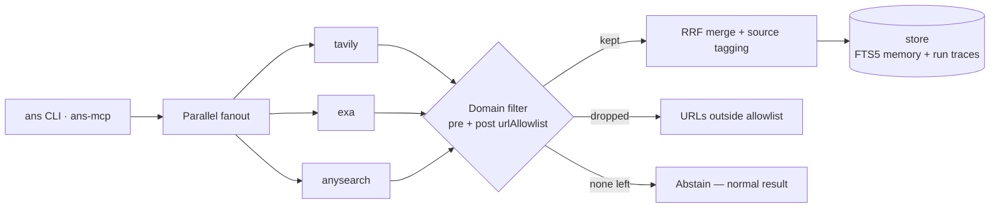

# anysearch-cli

<p align="center">
  <picture>
    <source media="(prefers-color-scheme: dark)" srcset="./assets/readme/hero-dark.svg">
    
  </picture>
</p>

**English** | [简体中文](README.zh-CN.md)


[](https://www.npmjs.com/package/@anysearch-cli/cli)
[](https://github.com/Xxx91n/anysearch-cli/actions/workflows/ci.yml)
[](LICENSE)

A vertical-domain information specialist CLI: put search, research, memory, and knowledge into one agent.
- Uses FTS5 for recall
- Uses RRF to merge results from multiple sources
- Ships with an MCP server that automatically indexes results
- A domain allowlist that actually filters the search results it returns (when one is configured; provider-written answers are not filtered)

## Quickstart

```bash
npm i -g @anysearch-cli/cli
ans doctor                                          # self-check: keys, database path, domain config parsing, provider readiness
ans search "tokio JoinSet rust"
ANS_DOMAIN=docs ans search "tokio JoinSet rust"     # search inside the docs domain only

# optional: add vector search, never installed automatically
npm i -g @anysearch-cli/embedding
```

## Post-install: Optional Vector Search

`@anysearch-cli/embedding` is an optional peer dependency (peer-optional). Without it, the CLI runs FTS-only.
After installing it (with npm or pnpm), first verify that it is actually active, then backfill vectors for existing records:

```bash
ans doctor                    # "vector arm (present ...)" means it is active
ans memory backfill-vectors   # backfill vectors for existing rows; downloads the model on first run (~130 MB)
```

- The model downloads from huggingface.co on first use and caches in `~/.anysearch/models`
(override the location with `ANYSEARCH_MODEL_CACHE`).
- On offline machines, you can copy an already populated cache directory from a connected machine. After uninstalling this package, the CLI falls back to FTS-only without crashing, and `ans doctor` marks this check as SKIP.

## Requirements

- Node.js >= 22
- pnpm 11.24.0, pinned; corepack automatically reads `packageManager`
- Searching needs at least one reachable provider (`ans recommend` only reads local domain configs and needs no key):
  - `EXA_API_KEY`: Exa, supports domain filtering; Exa needs a key.
  - `TAVILY_API_KEY`: Tavily, supports domain filtering; Tavily also runs without a key by default.
  - `ANYSEARCH_API_KEY`: anysearch MCP, optional; the anonymous tier works too, but cannot pre-filter by domain.

## Domains & Abstain

A *domain* is a TOML file under `domains/` (or `ANS_DOMAINS_DIR`).
It declares which providers this domain uses, along with an authoritative allowlist `urlAllowlist`.

```bash
export ANS_DOMAIN=docs      # select active domain
```

Filtering happens in two steps:

1. **Step 1: pre-filter before search**: if a provider declares it supports domain filtering, we pass the allowlist straight to it
   (`tavily` hard-filters via `include_domains`, `exa` uses `includeDomains`). For providers that do not support it
   (such as `anysearch`), we do not pass it and wait for step 2; we never pretend a provider can filter.
2. **Step 2: post-filter after search, which has the final say**: when providers return results, the retrieval engine drops any URL not on the allowlist before merging results and tagging sources. Deny rules take priority. Allowlist entries cover both the domain itself and its subdomains.

Filtering only runs when the effective allowlist is non-empty. A domain TOML without `urlAllowlist` normally returns unfiltered results (the dev-only `ANS_URL_ALLOWLIST` override can still add hosts when `ANS_ALLOW_ENV_OVERRIDE` is on). If `ANS_DOMAIN` names a domain that cannot be found, search falls back to every provider and turns the allowlist off too, so verify the domain name and the TOML first.

When filtering leaves zero results, `ans` will **abstain**. This is a normal result, not an error:

```text
abstain: no results within allowed cold domain(s) (pre-filtered 0, post-filtered 0, gate pre)
```

- Default exit code is **0** (abstaining counts as a successful run). When you pass `--fail-on-abstain`, automation gets a dedicated exit code **3**.
- `--json` includes `abstain: { abstain: true, reason, domain, preFiltered, postFiltered, gate }`.
  MCP tools put the same object in `structuredContent.abstain`, and `isError` stays false.
- Every domain search writes two audit events into the run trace: `retrieval.domain_filter.pre` and
  `retrieval.domain_filter.post`.
- For `research_web`, the abstain marker describes only the last round; earlier rounds may already have results.

> Exit codes: `0` ok or abstain · `1` generic failure, or zero results without a domain policy · `2` usage error · `3` abstain under `--fail-on-abstain`.

### Writing domain descriptions (`ans recommend`)

```bash
ans recommend "<free text>"
```

- Ranks domains using BM25 over **`name` + `description` only**
(adds vector search if `@anysearch-cli/embedding` is installed; falls back to FTS-only without it).
- It outputs the top 3 candidates along with a confidence score. High confidence suggests `ans domain <id>`; low confidence lists candidates with a machine-readable explanation of why nothing was recommended. It never switches domains on its own. The description decides when the model picks this domain, so write it like this (community reports and arXiv 2604.04323 both found that vague descriptions silently fail to trigger):

- Clearly state **what this domain does** and include **concrete nouns users actually type**: tools, formats, sites (such as `MCP spec / TypeScript tsconfig / pnpm settings`), using fewer adjectives.
- Add **key trigger words** that distinguish it from neighboring domains. Avoid negative phrasing like "not domain X" — every word in the description gets indexed, and it cannot understand negation.
- Keep it to one line, ≤ ~250 characters (matching the character limit for descriptions in agent skill registries). Keep `name` short and direct; both fields go straight into the index.

> Domains can also inject internal data into the agent's context through `[rag] adapter`: `none` (default), `note` (legacy fixed text), or `fts` (real FTS5 memory recall with provenance tags). See [docs/rag-adapters.md](docs/rag-adapters.md).

### Installing Agent Skills (`ans skill`)

```bash
ans skill install /path/to/checkout/skills/research
ans skill validate             # validate all installed skills; optionally pass one name
ans skill list
ans skill uninstall research

# project scope: add --project to each command
ans skill install /path/to/checkout/skills/research --project
ans skill validate --project
ans skill list --project
ans skill uninstall research --project
```

`ans skill` only copies a directory inside a local Git checkout (one that contains a `SKILL.md`) into `skills/synced/`,
recording its source and commit. It is not a package manager and does not execute skill code. Locking, manifests, and cleanup live in `apps/cli/src/skill-store.ts`.

**Installed does not mean active.** These commands never touch domain TOML files. Which skills can run is still decided by `[skills].active` in the current domain. You activate them the same way as before: by editing the domain config.

## Provider Connections & Capabilities

| Provider | Transport | Wired search features | Answer mode | Pre-filter domains | Vertical routing | Cancellable | Standalone usage endpoint |
|----------|-----------|-----------------------|-------------|--------------------|------------------|-------------|---------------------------|
| anysearch | MCP Streamable HTTP (`POST /mcp`, hand-rolled JSON-RPC; not the official SDK) | `search` (fast / index / deep; `answer` requests fall back to plain search) | no | no (post-filter only) | yes (`domain` / `sub_domain` / `sub_domain_params`) | yes (fetch signal on each POST; shared-handshake details below) | no |
| exa | official `exa-js` SDK | `search` (fast / index / deep / answer) | yes (`answer()` with citations, `verified:false`; answer failures fall back to plain search results and print one line to stderr) | yes (`includeDomains`, only applies to `search()`; see below) | no | yes (`signal` as the last option in `search()` / `answer()` requests; #216) | no |
| tavily | official `@tavily/core` SDK | `search` (fast / index / deep / answer) | yes (`includeAnswer`) | yes (`include_domains`, hard filter) | no | no (`@tavily/core@0.7.7` has no signal; #32) | no |

Providers are chosen from `sources.enabled` in the domain TOML. Providers with missing keys are skipped without crashing the search. If no providers can connect at all, the search throws an error directly instead of treating it as an abstain.

This table only lists features that our adapters actually wire up, not everything in the upstream catalogs. AnySearch is the only MCP upstream here. Exa and Tavily continue to use their official SDKs; their hosted MCP servers are tools meant for agents directly, not the interface our server-side providers need. **We have no plans to migrate Exa or Tavily to MCP.**

Two details from the table need special mention: AnySearch sends a signal on every POST, but concurrent searches share a single MCP handshake. This handshake only follows the first caller's signal; subsequent callers cannot cancel that wait, and if the first caller cancels, both searches may fail together. Exa's `includeDomains` only applies to `search()`; a separate `answer()` call does not receive the allowlist, and the retrieval engine does not filter URLs in answer text or citations.

The AnySearch adapter only wires `search`. It does not wire `get_sub_domains`, `batch_search`, `extract`, or `score` (which exists on the live service but is omitted from official docs). Upstream tool counts are not hardcoded: official docs list four tools, while the live service has also returned `score`. When a successful `search` response carries a non-empty `_meta.request_id` and the caller provided a run trace (both CLI and MCP tool calls do), we record it as a diagnostic correlation ID (`retrieval.provider.diagnostic`). Failed responses throw before extraction and record nothing. This ID never enters results and cannot be used as an idempotency key (you cannot deduplicate retries with it).

## AnySearch Vertical Domains

AnySearch also provides a separate **vertical routing** axis. You can pass it per query or configure it in the domain TOML. It is completely separate from hostname allowlists and has nothing to do with `urlAllowlist`.

- Query-level arguments: `verticalDomain` / `verticalSubDomain` / `verticalParams` on `search_web` / `research_web`; CLI flags `--vertical-domain` / `--vertical-sub-domain` / `--vertical-params '{"k":"v"}'`. Passing query-level arguments replaces the TOML defaults completely without deep merging.
- Repo defaults: `[sources] vertical = { domain = "finance" }`. `sub_domain` is optional here, but parameterized tags like `calendar` must receive `sub_domain_params` (`--vertical-params`) at query time, or upstream will reject them.
- Provider capability checks: only providers declaring `verticalDomainSupported` (currently only anysearch) receive `domain` / `sub_domain` / `sub_domain_params`. Other providers do not receive them, proceed with a normal query, and are listed under `anysearch.vertical.degraded` in the `retrieval.vertical.pre` audit event. Dropping this hint never causes an abstain.
- Audit: each vertical search writes one `retrieval.vertical.pre` audit event, recording parameter key names only, never values. Matching results carry `extra.vertical` for machine consumption.

For the full vocabulary and live upstream test results, see [docs/vertical-domains.md](docs/vertical-domains.md).

## MCP Server

```bash
npm i -g @anysearch-cli/mcp                     # provides the ans-mcp command
ans-mcp                                         # stdio transport (default)
ans-mcp --transport http --port 3001            # Streamable HTTP (localhost-only)
```

When running from source, the same entry point is:
`node apps/mcp/dist/index.js [--transport http] [--port <n>]`.

Five tools: `search_web`, `research_web`, `recall_memory`, `query_knowledge`, and `ans_chat`.
`ANS_DOMAIN` scopes the server via process environment variables: export it explicitly when starting `ans-mcp` directly; `ans mcp` inherits the domain selected in the CLI. Tools never write to stdout, keeping the protocol channel clean.

For tool arguments, `isError` / empty result / abstain semantics, both transports, environment variables and authentication, the `ans_chat` session ID, how both protocol generations are handled, and upstream provider details, see the specification reference in [docs/mcp-server.md](docs/mcp-server.md).

## How It Works

How a single search works: providers fan out to query in parallel, results are filtered by domain, merged, and saved to the database.



## Verified Agent Hosts

| Host | Version | Verified scope | Status |
|------|---------|----------------|--------|
| CodeBuddy Code | 2.151.0 | `mcp.json` registration + `.codebuddy/settings.json` hooks | Live-tested · [doc](docs/codebuddy-integration.md) |
| Claude Code | 2.1.251 | `mcp.json` registration + `.claude/settings.json` hooks + plugin skeleton | Live-tested · [doc](docs/claude-integration.md) |
| Codex CLI | 0.142.5 | `config.toml` MCP registration + `.codex/hooks.json` hooks | Live-tested · [doc](docs/codex-integration.md) |
| Antigravity CLI (`agy`) | 1.2.5 | named-hook map `hooks.json` (5 events passed via argv) | Live-tested (partial scope) · [doc](docs/antigravity-integration.md) |
| Antigravity IDE | 2.12.2 | `.antigravity/rules/anysearch.mdc` fallback | IDE host does not execute hooks (reproduced) · [doc](docs/antigravity-integration.md) |
| DeepSeek Harness (`dsh`) | 0.2.2-rc.1 | native registration (`ctx.tools`) + `dsh-plugin` Cordis bundle | Live-tested (web UI + live reload) · [doc](docs/deepseek-harness-integration.md) |

"Verified" means tested end-to-end on a real host and captured in full conversation logs (`stream-json`), not just matching interfaces on paper. Full scopes, dates, and probe evidence are documented in each integration guide.

## Known Limitations

| Limitation | Impact |
|------------|--------|
| macOS exit-time `libc++abi` aborts | Root cause is calling `process.exit()` while native objects are still alive, not a leaked sqlite handle. Store exits now close handles and let the event loop end naturally, and macOS is back in the blocking `ship-gate` checks. As long as a forced exit happens with live native objects, it can still abort; `macos-spillover-probe` keeps running as a non-blocking warning check |
| The `anysearch` provider cannot pre-filter domains | Its MCP `domain` parameter is an enum for vertical routing, not a hostname allowlist. When an allowlist is configured, it can only filter after results return |
| The `anysearch` adapter only wires `search` | `get_sub_domains`, `batch_search`, `extract`, and the live-but-undocumented `score` are not wired. Upstream tool count is not pinned (official docs list four tools, while the live endpoint has also returned `score`). A successful `search` reply's `_meta.request_id` is only diagnostic data in run traces, recorded only when the caller supplies a span; failed replies record nothing. It never enters results and cannot be used as an idempotency key |
| Exit-time `libc++abi` aborts may mask the abstain exit code | Automation must read the structured abstain marker (`--json` / `structuredContent.abstain`) instead of relying on the exit code alone |
| `rag.adapter = "fts"` is not enabled on any shipped domain | All three shipped domains stay on `adapter = "none"`. To enable it for a domain, configure it explicitly (#130) |
| `query_knowledge` only retrieves when the active domain enables `rag.adapter = "fts"` | It reads the store-wide shared research database through the domain retrieval adapter registry (#155). `none` and `note` return explicit empty results. Shipped domains are all `none`, so default installations answer empty |
| Omitting `[rag]` is not the same as `adapter = "none"` | The `rag` section replaces the whole section when declared: derived domains inherit their base domain's adapter/note, and inheritance chains without any adapter fail validation |
| `rag.adapter = "fts"` reads the **store-wide shared** research database, not the current session | This is an intentional boundary (#130): the store is the unit of isolation; sessions and domains are sub-scopes under it. Shipped domains default to `none`, so `fts` injection must be enabled manually (`recall_memory` already reads this same store scope) |
| MCP protocol versions: `2026-07-28` clients negotiate down to `2025-11-25` | stdio and stateless Streamable HTTP `initialize` return `2025-11-25` to modern clients, and all five tools work normally; older clients get their own version echoed back. Hand-rolled paths only support the legacy version: under stdio or in-memory (or HTTP without the `MCP-Protocol-Version` header), `server/discover` with a modern `_meta` returns `-32601`, and `tools/list` falls back to the legacy five-tool list. On HTTP, non-initialize requests carrying `MCP-Protocol-Version: 2026-07-28` are rejected before dispatch by the transport layer (HTTP 400 / JSON-RPC `-32000`); use the negotiated `2025-11-25`. See [docs/mcp-server.md](docs/mcp-server.md) |
| MCP client identity is only valid within a single request | A `2026-07-28` `tools/call` carrying `_meta["io.modelcontextprotocol/clientInfo"]` records the mapped `client_id`; legacy `2025-11-25` stateless HTTP calls have no per-request identity and record `mcp_unknown`. Extracting at `initialize` time is a fallback, not a cross-request guarantee |

Full record: [docs/limitations.md](docs/limitations.md).

## Why It's Designed This Way

- **Vertical domains**: a domain is just a TOML file with a strict, authoritative allowlist `urlAllowlist` enforced by the retrieval engine, not a prompt wish hoping the model plays along.
- **Say so when there are no results**: when filtering leaves nothing, it cleanly abstains instead of making up answers.
- **When something breaks, skip it**: when hooks, providers, or optional components fail, they get skipped so they never crash the host agent.

## For Contributors

- `GLOSSARY.md`: authoritative domain glossary (read this first)
- `docs/mcp-server.md`: MCP server specification reference (tools, semantics, transports, environment variables, and auth)
- `docs/rag-adapters.md`: domain retrieval adapter configs (`none` / `note` / `fts`), injected content, and size limits
- `docs/limitations.md`: complete record of known limitations
- `docs/agents/`: conventions for domain docs and GitHub issue tracker
- Repository layout: `packages/kernel` (engine) · `packages/store` (FTS5 memory, run traces, URL policy) · `packages/retriever` (provider adapters + RRF) · `apps/cli` · `apps/mcp` · `apps/plugin` (host hooks)
- Run single-package tests with `node --import tsx --test`; the full pre-release check is `node scripts/ship-gate.mjs` (no uncommitted changes, test suite, packaging, install verification, MCP initialize, startup when a component is broken)
- Governance: `AGENTS.md`, `docs/agents/`

Build from source:

```bash
git clone <this repo> && cd anysearch-cli
pnpm install --ignore-scripts --node-linker=hoisted   # better-sqlite3 uses prebuilt binaries, no node-gyp; hoisted avoids Windows EPERM
pnpm build
node apps/cli/dist/index.js doctor
ANS_DOMAIN=docs node apps/cli/dist/index.js search "tokio JoinSet rust"

# machine-readable output (includes sufficiency check, source tags, and abstain)
node apps/cli/dist/index.js search "..." --json
```

The CLI resolves to `ans` when installed globally or linked. Inside the repository, `node apps/cli/dist/index.js` is the exact same entry point.
