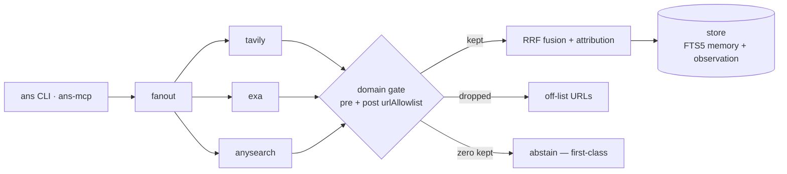

# anysearch-cli

<p align="center">
  
</p>

**English** | [简体中文](README.zh-CN.md)

> The English README is canonical; the Chinese version is kept in sync.

[](https://www.npmjs.com/package/@anysearch-cli/cli)
[](https://github.com/Xxx91n/anysearch-cli/actions/workflows/ci.yml)
[](LICENSE)

A vertical-domain information-specialist CLI: search, research, memory, and
knowledge in one agent. It uses FTS5 for recall, RRF to merge results from
several providers, ships an MCP server that indexes results automatically, and
puts a domain allowlist in front of what comes back.

Published on npm: `npm i -g @anysearch-cli/cli`. Versions 0.0.1/0.0.2 were
revoked because of a `workspace:*` dependency escape; see CHANGELOG.

A gated search looks like this:

```text
$ ANS_DOMAIN=docs ans search "model context protocol"
1. [tavily] What is the Model Context Protocol (MCP)? ...
2. [exa] ...
3. [exa] ...

# when the domain has no results, it abstains instead of failing:
abstain: no results within allowed cold domain(s) (pre-filtered 0, post-filtered 0, gate pre)
```

## Requirements

- Node.js >= 22 (Node 24 verified)
- pnpm 11.24.0 exactly; corepack reads `packageManager` automatically
- At least one provider API key for real searches:
  - `EXA_API_KEY`: Exa, supports domain filtering
  - `TAVILY_API_KEY`: Tavily, supports domain filtering
  - `ANYSEARCH_API_KEY`: anysearch MCP, optional; the anonymous tier works but cannot pre-filter by domain

## Quickstart

```bash
npm i -g @anysearch-cli/cli
ans doctor                                          # self-check: keys, DB path, domain resolution, provider readiness
ans search "tokio JoinSet rust"
ANS_DOMAIN=docs ans search "tokio JoinSet rust"     # search inside the docs domain only

# optional: vector arm, never installed automatically
npm i -g @anysearch-cli/embedding
```

## Post-install: vector arm

`@anysearch-cli/embedding` is peer-optional; without it the CLI runs FTS-only.
After a global install (npm or pnpm), confirm it is active and embed existing
rows:

```bash
ans doctor                    # "vector arm (present ...)" confirms activation
ans memory backfill-vectors   # embeds stored rows; the first run downloads the model (~130 MB)
```

The model downloads from huggingface.co on first use and is cached at
`~/.anysearch/models` (override with `ANYSEARCH_MODEL_CACHE`). On an offline
host, copy a populated cache directory from a connected machine. Removing the
package returns the CLI to FTS-only mode with no crash; `ans doctor` reports
that arm as SKIP.

## Domains & abstain

A *domain* is a TOML file under `domains/` (or `ANS_DOMAINS_DIR`). It names the
providers for that domain and carries an authoritative `urlAllowlist`.
`ANS_DOMAIN` selects the active domain.

Filtering runs as two gates:

1. **Pre-filter (capability-negotiated)**: providers that declare domain-filter
   support receive the allowlist directly (`tavily` uses `include_domains` in
   hard-filter mode; `exa` uses `includeDomains`). Providers without that
   support (for example `anysearch`) fall back to post-filter only and never
   pretend to filter.
2. **Post-filter (authoritative)**: after providers return, the kernel drops
   every URL that is not in the allowlist before fusion and attribution. Deny
   rules win; allow entries match a host and its subdomains.

When the gate leaves zero results, `ans` **abstains**. That is a first-class
result, not an error:

```text
abstain: no results within allowed cold domain(s) (pre-filtered 0, post-filtered 0, gate pre)
```

- Exit code **0** by default (abstention is a successful policy outcome);
  `--fail-on-abstain` returns dedicated exit code **3** for automation.
- `--json` carries `abstain: { reason, domain, preFiltered, postFiltered, gate }`;
  MCP tools expose the same marker as `structuredContent.abstain` with
  `isError: false`.
- Each domain-scoped search writes two audit events into the observation trace:
  `retrieval.domain_filter.pre` and `retrieval.domain_filter.post`.

Exit codes: `0` ok or abstain · `1` generic failure, or zero results without a
domain policy · `2` usage error · `3` abstain under `--fail-on-abstain`.

### Writing domain descriptions (`ans recommend`)

`ans recommend "<free text>"` ranks domains by BM25 over **`name` +
`description` only** (plus an optional embedding arm when
`@anysearch-cli/embedding` is installed; without it the command falls back to
FTS-only). It prints the top three candidates with a confidence score. High
confidence suggests `ans domain <id>`; low confidence lists the candidates and
a structured "why no recommendation" line. It never switches domains by
itself. The description is the trigger surface, so write it like this
(community reports and arXiv 2604.04323 both found that vague descriptions
silently never fire):

- State **what the domain is for** and the **concrete nouns a user would
  actually type**: tools, formats, sites (for example `MCP spec / TypeScript
tsconfig / pnpm settings`), not adjectives.
- Add the **differentiating keywords** that separate it from sibling domains,
  and imply what it is *not* (the corpus inclusion rule).
- One line, ≤ ~250 characters (the same budget used by agent-skill
  registries); keep `name` short and literal. Both fields are indexed verbatim.

A domain can also inject its own private/internal data into the agent context
through `[rag] adapter`: `none` (default), `note` (legacy fixed text), or `fts`
(real FTS5 memory recall with provenance tags). See
[docs/rag-adapters.md](docs/rag-adapters.md).

### Installing Agent Skills (`ans skill`)

```bash
ans skill install /path/to/checkout/skills/research
ans skill validate             # validate all installed skills; optionally pass one name
ans skill list
ans skill uninstall research

# project scope: add --project to each command
ans skill install /path/to/checkout/skills/research --project
ans skill validate --project
ans skill list --project
ans skill uninstall research --project
```

`ans skill` copies a self-contained directory with a root `SKILL.md` from a
local Git checkout into `skills/synced/`, and records the source and commit.
It is not a package manager and does not run skill code. Locking, manifests,
and residue cleanup are documented under the Skill Installer entry in
`GLOSSARY.md`.

**Installation is not activation.** These commands never edit domain TOML.
The Active Domain's `[skills].active` remains the authority for the Skill
Active List; manage activation through the domain configuration as before.

## Provider transport & capability matrix

| provider | transport | wired search surface | answer mode | domain pre-filter | vertical routing | cancellation | standalone usage |
|----------|-----------|----------------------|-------------|-------------------|------------------|--------------|------------------|
| anysearch | MCP Streamable HTTP (`POST /mcp`, hand-rolled JSON-RPC; not the official SDK) | `search` (fast / index / deep; an `answer` request degrades to a plain search) | no | no (post-filter only) | yes (`domain` / `sub_domain` / `sub_domain_params`) | yes (per-POST fetch signal; shared-handshake caveat below) | no |
| exa | official `exa-js` SDK | `search` (fast / index / deep / answer) | yes (`answer()` with citations, `verified:false`; an answer failure degrades to results plus one stderr line) | yes (`includeDomains`, `search()` only; see below) | no | yes (`signal` as the trailing request option on `search()` / `answer()`; #216) | no |
| tavily | official `@tavily/core` SDK | `search` (fast / index / deep / answer) | yes (`includeAnswer`) | yes (`include_domains`, hard filter) | no | no (`@tavily/core@0.7.7` exposes no signal; #32) | no |

Provider selection comes from the domain TOML's `sources.enabled`. A provider
with a missing key is skipped instead of crashing the search; if *no* provider
can register, the search is an error, not an abstain.

The matrix records what the adapters actually wire, not what each upstream
catalog offers. AnySearch is the only MCP upstream here; Exa and Tavily stay on
their official SDKs. Their hosted MCP servers are agent-facing tool surfaces,
not a server-side provider API. **No Exa/Tavily MCP migration is planned.**

Two cancellation caveats sit behind the matrix. AnySearch sends a signal on
every POST, but concurrent searches share one MCP handshake. That handshake
follows the first caller's signal, so later callers cannot cancel the wait, and
aborting the first caller can fail both searches. Exa's `includeDomains` only
applies to `search()`; the separate `answer()` call does not receive the
allowlist, and the kernel does not URL-gate answer text or citations.

The AnySearch row is `search`-only at the adapter level: `get_sub_domains`,
`batch_search`, `extract`, and the live-but-undocumented `score` tool are not
wired. The upstream tool count is deliberately not pinned: official docs list
four tools, while the live endpoint has also returned `score`. A successful
`search` reply's non-empty `_meta.request_id` is recorded as a diagnostic
correlation id on the observation span (`retrieval.provider.diagnostic`) only
when the caller supplies a span (CLI and MCP tool calls do). Failed replies
throw before extraction, so nothing is recorded for them. That id never enters
query results and is never an idempotency key.

## AnySearch vertical domains

AnySearch also exposes a separate **vertical routing** axis. Set it per query
or in the domain TOML. It is not a hostname allowlist and has nothing to do
with `urlAllowlist`.

- Query-level arguments: `verticalDomain` / `verticalSubDomain` /
  `verticalParams` on `search_web` / `research_web`; CLI flags
  `--vertical-domain` / `--vertical-sub-domain` /
  `--vertical-params '{"k":"v"}'`. Query-level values replace the TOML default
  wholesale; there is no deep merge.
- Repo default: `[sources] vertical = { domain = "finance" }` in the domain
  TOML. `sub_domain` is optional here, but parameterized tags such as
  `calendar` fail upstream without `sub_domain_params`, which live at query
  level via `--vertical-params`.
- Capability negotiation: only providers declaring `verticalDomainSupported`
  (currently just anysearch) receive the wire fields `domain` / `sub_domain` /
  `sub_domain_params`. Other providers fan out on the general axis and are
  named in the `retrieval.vertical.pre` audit event's
  `anysearch.vertical.degraded` list. A lost hint is never an abstain.
- Audit: one `retrieval.vertical.pre` event per vertical search records
  parameter key names only, never values; hits carry an `extra.vertical`
  machine-readable marker.

See [docs/vertical-domains.md](docs/vertical-domains.md) for the dated
vocabulary snapshot and observed upstream behavior.

## MCP server

```bash
npm i -g @anysearch-cli/mcp                     # provides the ans-mcp bin
ans-mcp                                         # stdio transport (default)
ans-mcp --transport http --port 3001            # Streamable HTTP (localhost-only)
```

From a checkout, the same entry is
`node apps/mcp/dist/index.cjs [--transport http] [--port <n>]`.

Five tools: `search_web`, `research_web`, `recall_memory`, `query_knowledge`,
and `ans_chat`. `ANS_DOMAIN` scopes the server through the process
environment: export it when launching `ans-mcp` directly; `ans mcp` also
inherits the CLI's persisted choice. Tools never print to stdout; the server
keeps the protocol channel pure.

The canonical reference covers tool arguments, `isError` / empty / abstain
semantics, both transports, environment variables and auth, the `ans_chat`
session handle, dual-era behavior, and the upstream provider matrix:
[docs/mcp-server.md](docs/mcp-server.md).

## How it works

One pass through the pipeline: providers fan out, the domain gate filters,
results fuse and persist.



## Verified agent hosts

| Host | Version | Verified scope | Status |
|------|---------|----------------|--------|
| CodeBuddy Code | 2.151.0 | `mcp.json` registration + `.codebuddy/settings.json` hooks | live-verified · [doc](docs/codebuddy-integration.md) |
| Claude Code | 2.1.251 | `mcp.json` registration + `.claude/settings.json` hooks + plugin skeleton | live-verified · [doc](docs/claude-integration.md) |
| Codex CLI | 0.142.5 | `config.toml` MCP registration + `.codex/hooks.json` hooks | live-verified · [doc](docs/codex-integration.md) |
| Antigravity CLI (`agy`) | 1.2.5 | named-hook map `hooks.json` (5 events via argv) | live-verified (reduced matrix) · [doc](docs/antigravity-integration.md) |
| Antigravity IDE | 2.12.2 | `.antigravity/rules/anysearch.mdc` fallback | hooks not executed (reproduced) · [doc](docs/antigravity-integration.md) |
| DeepSeek Harness (`dsh`) | 0.1.7-rc.2 | native registration (`ctx.tools`) + `dsh-plugin` Cordis bundle | live-verified (established-via-fallback) · [doc](docs/deepseek-harness-integration.md) |

"Verified" means an end-to-end transcript captured on the real host
(`stream-json`), not just matching interfaces on paper. Full scope, dates, and
probe evidence live in the linked integration docs.

## Known limitations

| Limitation | Why it matters |
|------------|----------------|
| exit-time `libc++abi` aborts on macOS | root cause: forced `process.exit()` while native state was still alive, not a leaked sqlite handle. Store-side exits now close handles and let the loop end, and macOS is a blocking `ship-gate` leg again. Anything that force-exits a process with live native state can still abort; the non-blocking `macos-spillover-probe` job stays as an early-warning reporter |
| `anysearch` provider cannot pre-filter | its MCP `domain` parameter is a vertical-routing enum, not a hostname allowlist; with a domain allowlist it honestly falls back to post-filter only |
| the `anysearch` adapter wires `search` only | `get_sub_domains`, `batch_search`, `extract`, and the live-but-undocumented `score` are not wired. The upstream tool count is not pinned (official docs list four; the live endpoint has also returned `score`). A successful `search` reply's `_meta.request_id` is observation-trace diagnostic data only, and only when the caller supplies a span; failed replies record nothing. It never enters results and is never an idempotency key |
| exit-time `libc++abi` may overwrite the abstain exit code | automation must read the structured abstain marker (`--json` / `structuredContent.abstain`), not the exit code alone |
| `rag.adapter = "fts"` is not enabled on any shipped domain | all three shipped domains stay on `adapter = "none"`; enabling it per domain is an explicit opt-in product decision (#130) |
| `query_knowledge` only retrieves when the active domain enables `rag.adapter = "fts"` | it dispatches through the RAG registry over store-level shared Research Memory (#155); `none` / `note` return an explicit empty result, and every shipped domain stays on `none`, so a default install answers empty |
| omitting `[rag]` is not the same as `adapter = "none"` | `rag` is a replace-on-declare section: a derived domain inherits its base's adapter/note, and a chain with no adapter fails validation outright |
| `rag.adapter = "fts"` reads **store-level shared** Research Memory, not the current session | deliberate boundary (#130): the store is the isolation unit; sessions and domains are sub-scopes. Every shipped domain stays on `none`, so the `fts` prompt injection is opt-in (the same store-wide range is already read by `recall_memory`) |
| MCP dual-era: a `2026-07-28` client is negotiated down to `2025-11-25` | stdio and stateless Streamable HTTP `initialize` return `2025-11-25` for a modern client and all five tools still work; legacy clients get their own version echoed. The hand-wired path stays legacy-only: on stdio/in-memory (or HTTP without the `MCP-Protocol-Version` header), `server/discover` returns `-32601` even with a modern `_meta` envelope, while `tools/list` still degrades to the five-tool legacy list. On HTTP, a non-initialize request sending `MCP-Protocol-Version: 2026-07-28` is rejected before dispatch with HTTP 400 / JSON-RPC `-32000`; use the negotiated `2025-11-25`. See [docs/mcp-server.md](docs/mcp-server.md) |
| MCP client identity is per-request only | a `2026-07-28` `tools/call` carrying `_meta["io.modelcontextprotocol/clientInfo"]` records the mapped `client_id`; a legacy `2025-11-25` stateless HTTP call has no per-request identity and records `mcp_unknown`. The `initialize`-time extraction is a fallback, not a cross-request guarantee |

Full record: [docs/limitations.md](docs/limitations.md).

## Design rationale

- **Vertical-domain**: domains are TOML policy files with an authoritative
  `urlAllowlist` enforced in the kernel, not prompt wishes.
- **Abstain-first**: an empty gated result is a first-class abstain, never a
  hallucinated answer.
- **Fail-open**: hooks, providers, and optional peers degrade honestly instead
  of breaking the host agent.

## For contributors

- `GLOSSARY.md`: canonical domain glossary (read first)
- `docs/mcp-server.md`: canonical MCP server reference (tools, semantics, transports, env/auth)
- `docs/rag-adapters.md`: RAG adapter configuration (`none` / `note` / `fts`), injection shape, and budgets
- `docs/limitations.md`: full known-limitations record
- `docs/agents/`: domain-doc + GitHub issue tracker conventions
- Repo layout: `packages/kernel` (engine) · `packages/store` (FTS5 memory,
  observation, URL policy) · `packages/retriever` (provider adapters + RRF) ·
  `apps/cli` · `apps/mcp` · `apps/plugin` (host hooks)
- Per-package tests run under `node --import tsx --test`; the full gate is
  `node scripts/ship-gate.mjs` (clean tree, tests, pack, install verify, MCP
  initialize, fail-open boot)
- Governance: `AGENTS.md`, `docs/agents/`

Build from source:

```bash
git clone <this repo> && cd anysearch-cli
pnpm install --ignore-scripts --node-linker=hoisted   # prebuilt better-sqlite3, no node-gyp; hoisted avoids Windows EPERM
pnpm build
node apps/cli/dist/index.js doctor
ANS_DOMAIN=docs node apps/cli/dist/index.js search "tokio JoinSet rust"

# machine-readable output (includes sufficiency / attribution / abstain)
node apps/cli/dist/index.js search "..." --json
```

The CLI resolves as `ans` when installed globally or linked; in repo form,
`node apps/cli/dist/index.js` is the same entry point.
