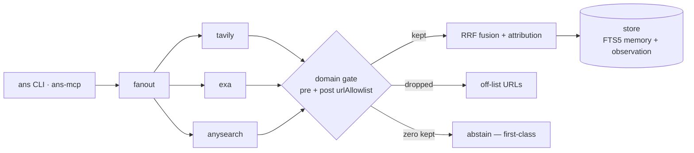

# anysearch-cli

<p align="center">
  
</p>

**English** | [简体中文](README.zh-CN.md)

> This document is canonical; [README.zh-CN.md](README.zh-CN.md) is the derived translation.

[](https://www.npmjs.com/package/@anysearch-cli/cli)
[](https://github.com/Xxx91n/anysearch-cli/actions/workflows/ci.yml)
[](LICENSE)

A vertical-domain information-specialist CLI: search + research + memory +
knowledge in one agent — FTS5 recall, multi-source RRF fusion, an MCP server
that auto-indexes results, and a domain allowlist that actually gates what
comes back.

**Status: published on npm** — `npm i -g @anysearch-cli/cli` (npm OIDC trusted
publishing with sigstore provenance since 0.0.4; 0.0.1/0.0.2 were revoked over
a `workspace:*` peer escape — see CHANGELOG).

What a gated search looks like — every returned URL sits inside the domain's
`urlAllowlist`; an empty gated result is a first-class abstain:

```text
$ ANS_DOMAIN=docs ans search "model context protocol"
1. [tavily] What is the Model Context Protocol (MCP)? - Model Context Protocol
   modelcontextprotocol.io/
2. [exa]
   modelcontextprotocol.io/specification/2026-07-28/basic
3. [exa]
   modelcontextprotocol.io/specification/2026%2D07%2D28
   …

# when the gate leaves zero results — a first-class abstain, not an error:
abstain: no results within allowed cold domain(s) (pre-filtered 0, post-filtered 0, gate pre)
```

## Requirements

- Node.js >= 22 (Node 24 verified)
- pnpm 11.24.0 exactly (pinned; corepack reads `packageManager` automatically)
- At least one provider API key for real searches:
  - `EXA_API_KEY` — Exa (supports domain filtering)
  - `TAVILY_API_KEY` — Tavily (supports domain filtering)
  - `ANYSEARCH_API_KEY` — anysearch MCP (optional; anonymous tier works, no domain filter)

## Quickstart

```bash
npm i -g @anysearch-cli/cli
ans doctor                                          # self-check: keys, DB path, domain resolution, provider readiness
ans search "tokio JoinSet rust"                     # first search (full fanout across keyed providers)
ANS_DOMAIN=docs ans search "tokio JoinSet rust"     # domain-scoped search

# optional vector arm (peer-optional — never auto-installed):
npm i -g @anysearch-cli/embedding
```

From source (contributors):

```bash
git clone <this repo> && cd anysearch-cli
pnpm install --ignore-scripts --node-linker=hoisted   # prebuilt better-sqlite3, no node-gyp; hoisted avoids Windows EPERM
pnpm build
node apps/cli/dist/index.js doctor
ANS_DOMAIN=docs node apps/cli/dist/index.js search "tokio JoinSet rust"

# machine-readable output (includes sufficiency / attribution / abstain)
node apps/cli/dist/index.js search "..." --json
```

The CLI resolves as `ans` when the package is installed globally or linked; in
repo form, `node apps/cli/dist/index.js` is the same entry point.

## Post-install: vector arm

`@anysearch-cli/embedding` is peer-optional — the CLI runs FTS-only without it.
After a global install (npm or pnpm), verify activation and embed existing rows:

```bash
ans doctor                    # "vector arm (present ...)" confirms activation
ans memory backfill-vectors   # embeds stored rows; first run downloads the model (~130 MB)
```

The model downloads from huggingface.co on first use and is cached at
`~/.anysearch/models` (override: `ANYSEARCH_MODEL_CACHE`). On an offline host,
copy a populated cache dir in from a connected machine. Removing the package
returns the CLI to FTS-only mode — no crash, `ans doctor` reports the arm as
SKIP.

## Domains & abstain

A *domain* is a TOML file under `domains/` (or `ANS_DOMAINS_DIR`) naming its
providers and an authoritative `urlAllowlist`. `ANS_DOMAIN` selects it.

Filtering runs as two gates:

1. **Pre-filter (capability-negotiated)** — providers that declare domain-filter
   support receive the allowlist directly (`tavily`: `include_domains` hard
   filter mode; `exa`: `includeDomains`). Providers without support (e.g.
   `anysearch`) degrade honestly to post-filter only — never a faked filter.
2. **Post-filter (authoritative)** — the kernel drops every returned result
   whose URL is not in the allowlist *before* fusion/attribution. Deny rules
   take precedence; allow entries match a host and its subdomains.

When the gate leaves zero results, `ans` **abstains** — a first-class result,
not an error:

```text
abstain: no results within allowed cold domain(s) (pre-filtered 0, post-filtered 0, gate pre)
```

- Exit code **0** by default (abstention is a successful policy outcome);
  `--fail-on-abstain` returns dedicated exit **3** for automation.
- `--json` carries `abstain: { reason, domain, preFiltered, postFiltered, gate }`;
  MCP tools surface `structuredContent.abstain` with `isError: false`.
- Two audit events land in the observation trace per domain-scoped search:
  `retrieval.domain_filter.pre` and `retrieval.domain_filter.post`.

Exit codes: `0` ok/abstain · `1` generic failure or zero results without a
domain policy · `2` usage error · `3` abstain under `--fail-on-abstain`.

### Writing domain descriptions (`ans recommend`)

`ans recommend "<free text>"` ranks domains by BM25 over **`name` +
`description` only** (plus an optional embedding arm when
`@anysearch-cli/embedding` is installed; without it the command degrades to
FTS-only). It prints top-3 candidates with a confidence score: high
confidence suggests `ans domain <id>`, low confidence lists the candidates
with a structured "why no recommendation" line — it never switches domains
by itself. So the description is the trigger surface; write it accordingly
(evidence: community reports + arXiv 2604.04323 both find vague descriptions
silently never fire — description quality is the make-or-break factor):

- State **what the domain is for** and the **concrete nouns a user would
  actually type** — tools, formats, sites (e.g. `MCP spec / TypeScript
  tsconfig / pnpm settings`), not adjectives.
- Add the **differentiating keywords** that separate it from sibling
  domains, and implicitly what it is *not* (the corpus inclusion rule).
- One line, ≤ ~250 characters (per-entry description budget precedent from
  agent-skill registries); keep `name` short and literal — both fields are
  indexed verbatim.

A domain can also inject its own **private/internal data** into the agent's
context through `[rag] adapter` — `none` (default), `note` (legacy fixed text)
or `fts` (real FTS5 memory recall, provenance-tagged). See
[docs/rag-adapters.md](docs/rag-adapters.md).

### Installing Agent Skills (`ans skill`)

`ans skill` is a minimal installer, not a package manager. It copies a
self-contained directory with a root `SKILL.md` from a **local Git checkout**.
Checkout the desired commit or tag first; the installer records that source,
the full HEAD commit, an exact tag when present, and whether the source was
dirty. Dirty detection streams `git status` and stops at the first entry, so a
checkout with a very large ignored or untracked tree stays installable instead
of failing on a full listing. It does not clone repositories, resolve
dependencies, or run skill code.

```bash
ans skill install /path/to/checkout/skills/research
ans skill validate             # all installed skills; optionally pass one name
ans skill list
ans skill uninstall research

# Project scope: add --project to each command
ans skill install /path/to/checkout/skills/research --project
ans skill validate --project
ans skill list --project
ans skill uninstall research --project
```

User scope is the default (`--user` selects it explicitly):

```text
~/.anysearch-cli/skills/synced/installed.json
~/.anysearch-cli/skills/synced/<name>/SKILL.md
<any project>/.anysearch/skills/synced/installed.json
<any project>/.anysearch/skills/synced/<name>/SKILL.md
```

`synced/` is machine-managed; sibling `skills/<name>/` directories remain
user-authored. `SKILL.md` must begin with a parseable YAML frontmatter mapping
whose `name` is 1–64 lowercase letters/digits with single hyphens (not a Windows
device name). That name selects the destination. This is a syntax/name check,
not a full Agent Skills linter. Git metadata is omitted and symlinks are
rejected; a source repository that defines local Git content-filter drivers
(`filter.<name>.clean`/`process`) is refused, because `git status` would
otherwise execute that repository-controlled code. Submodules are not inspected
for dirtiness. Existing installations are never overwritten (uninstall first).

The version-1 `installed.json` has a `skills` object keyed by name. Each entry
contains `name`, absolute `source`, `commit`, `dirty`, and optional `tag`.
Missing, malformed, or schema-invalid manifests cause uninstall to refuse
without deleting anything; uninstall never scans for guessed targets.
`install` and `uninstall` hold an exclusive lock in the selected scope, so two
concurrent mutations cannot lose each other's manifest entry. The lock records
its owner (`pid`, `host`, a stable machine identity, and the PID-namespace
identity where the OS exposes one) and is published with that record already
inside, so a lock never exists without an owner. The machine identity is
derived from `/etc/machine-id` (Linux), `MachineGuid` (Windows), or
`IOPlatformUUID` (macOS) — not from `hostname()`, so two hosts that share a
managed root and happen to use the same hostname cannot reclaim each other's
live locks. A lock whose owner is provably dead on the same machine and PID
namespace — including one left by a previous boot — is reclaimed automatically;
a live lock, a lock written on another machine or namespace, or one without a
readable owner or machine identity fails closed and is never deleted. To
recover manually, remove the lock directory when no `ans skill` process is
running on the machine that created it. An acquisition killed before
publication can leave `.installed.lock.pending-*`; a dead copy is cleaned in a
scope without `installed.json`, and any remaining copy is inert and can be
removed once no `ans skill` process is running. Manifest publication and the
install/uninstall directory renames retry transient Windows sharing violations
(`EPERM`/`EBUSY`/`ENOTEMPTY`) with bounded backoff for up to about 60 seconds
before reporting the original error; on other platforms only `EBUSY` is treated
as transient.

`install`, `list` and `validate` also reconcile installer-owned residue while
holding that lock. Residue is recognized by its exact generated name, never by a
prefix: `.install-` plus six alphanumerics (staging), `.installed-<uuid v4>.tmp`
(manifest temporary), `.installed.lock.pending-` plus six alphanumerics, and
`.installed.lock.reclaim-<uuid v4>` (reclamation quarantine).

Staging and a temp manifest are removed only in a scope without
`installed.json`. A pending or reclaimed lock is removed only once its recorded
owner is provably dead; a reclaimed lock that cannot be proven dead stops the
run with its path, while a pending lock with a live or unreadable owner is left
in place — it is inert, so it neither blocks nor stops a run.

The match is on shape, not authorship. Anything that merely looks similar — a
hand-made `.installed-notes.tmp`, an `.install-archive/` directory,
`.installed.lock.pending-<notes>` — is operator content: it is never deleted,
and a scope without `installed.json` keeps failing closed instead of
bootstrapping a manifest beside it. A name that happens to have exactly the
generated shape is indistinguishable from installer residue and is treated as
such — an operator directory named `.install-backup` is six alphanumerics after
`.install-`, so it is removed in a scope without `installed.json`. Avoid that
shape for your own files. `.uninstall-*` backups, unrecorded
`<name>/` directories and unknown entries are never deleted automatically. An unrecorded
`<name>/` left by an interrupted install can be removed manually and
reinstalled. If the manifest records a skill whose `<name>/` directory is
missing, `ans skill list` (and `validate`) prints a recovery hint: rename the
matching `.uninstall-*` backup back to `<name>/`, or run
`ans skill uninstall <name>` to drop the stale entry (add `--project` for
project scope). A `.installed-*.tmp` left next to an existing
`installed.json` is not removed automatically; inspect `skills/synced/` before
manual cleanup. Leftovers from an interrupted reclamation
(`.installed.lock.reclaim-*`) follow the same manifest-gated rule: they are
removed only in a scope without `installed.json`, and only when their recorded
owner is provably dead on this host; a manifest-bearing scope is never cleaned
automatically. If `ans skill list` itself reports a missing or invalid
manifest, inspect `skills/synced/` directly before removing anything.

**Installation is not activation.** These commands never edit domain TOML.
The Active Domain's `[skills].active` remains the authority for the Skill
Active List; manage activation through the domain configuration as before.

## Provider transport & capability matrix

| provider | transport | wired search surface | answer mode | domain pre-filter | vertical routing | cancellation | standalone usage |
|----------|-----------|----------------------|-------------|-------------------|------------------|--------------|------------------|
| anysearch | MCP Streamable HTTP (`POST /mcp`, hand-rolled JSON-RPC; not the official SDK) | `search` (fast / index / deep; an `answer` request degrades to a plain search) | no | no (post-filter only) | yes (`domain` / `sub_domain` / `sub_domain_params`) | yes (per-POST fetch signal; shared handshake caveat below) | no |
| exa | official `exa-js` SDK | `search` (fast / index / deep / answer) | yes (`answer()`, citations retained with `verified:false`; an answer failure degrades to results plus a stderr line) | yes (`includeDomains`, `search()` only; see note) | no | no (`exa-js@2.18.1` exposes no signal; #216) | no |
| tavily | official `@tavily/core` SDK | `search` (fast / index / deep / answer) | yes (`includeAnswer`) | yes (`include_domains`, hard filter) | no | no (`@tavily/core@0.7.7` exposes no signal; #32) | no |

Provider selection comes from the domain TOML's `sources.enabled`. Missing
keys skip that provider instead of crashing (fail-open); if *no* provider can
register, the search is an error, not an abstain.

The matrix records what the adapters actually wire, not what each upstream
catalog offers. Exa and Tavily stay on their official SDKs: their hosted MCP
servers are agent-facing tool surfaces, not a server-side provider API, and
**no Exa/Tavily MCP migration is planned**. AnySearch is the only MCP upstream
here because MCP is its native search transport, not because MCP is preferred
over SDKs for provider code.

Two caveats behind the matrix: AnySearch cancels each POST, but concurrent
searches share the one-time MCP handshake — it follows the first caller's
signal, so later callers cannot cancel that wait and aborting the first caller
can fail both searches. Exa's `includeDomains` applies only to `search()`; the
separate `answer()` call does not receive the allowlist, and the kernel does
not URL-gate answer text or citations.

The AnySearch row is `search`-only at the adapter level: `get_sub_domains`,
`batch_search`, `extract` and the live-but-undocumented `score` tool are not
wired. The upstream tool count is deliberately not pinned — the official docs
list four tools, while the live endpoint has also returned `score`. A successful `search` reply's non-empty `_meta.request_id` is recorded as a
diagnostic correlation id on the observation span
(`retrieval.provider.diagnostic`) when the caller supplies one (CLI and MCP
tool calls do). Failed replies throw before extraction, so no id is recorded
for them. The id never enters query results and is never an idempotency key.

## AnySearch vertical domains

The anysearch provider also exposes an orthogonal axis: a server-side
**vertical-domain router**. Set it per query — CLI flags or MCP tool args —
or per domain TOML; it is NOT a hostname allowlist and does not interact
with `urlAllowlist` at all.

- Query-level args (whole-replace the TOML default, never deep-merged):
  `verticalDomain` / `verticalSubDomain` / `verticalParams` on
  `search_web` + `research_web`; CLI `--vertical-domain` /
  `--vertical-sub-domain` / `--vertical-params '{"k":"v"}'`.
- Repo default: `[sources] vertical = { domain = "finance" }`
  in the domain TOML (static affinity only — `sub_domain` is optional here,
  but parameterized tags like `calendar` fail upstream without
  `sub_domain_params`, which live at query level via `--vertical-params`).
- Capability-negotiated: only providers declaring `verticalDomainSupported`
  (currently just anysearch) receive the wire fields `domain` /
  `sub_domain` / `sub_domain_params`; others fan out on the general axis
  and are named in the `retrieval.vertical.pre` audit event's
  `anysearch.vertical.degraded` list (a lost hint, never an abstain).
- Audit: one `retrieval.vertical.pre` event per vertical search —
  attributes `anysearch.vertical.domain` / `.sub_domain` / `.params_keys`
  (key *names* only, values never enter audit) / `.source` (repo|query) /
  `.sent` / `.degraded`. Vertical hits carry a machine-readable
  `extra.vertical` marker on each NormalizedResult.

The dated domain-vocabulary snapshot and observed upstream semantics moved to
[docs/vertical-domains.md](docs/vertical-domains.md).

## MCP server

```bash
node apps/mcp/dist/index.cjs                    # stdio transport (default)
node apps/mcp/dist/index.cjs --transport http --port 3099   # HTTP
```

Five tools: `search_web`, `research_web`, `recall_memory`, `query_knowledge`,
`ans_chat`. `ANS_DOMAIN` scopes the server the same way it scopes the CLI.
Tools never print to stdout; the server keeps the protocol channel pure.

## How it works

One pass through the pipeline — providers fan out, the domain gate filters,
results fuse and persist:



## Verified agent hosts

| Host | Version | Verified scope | Status |
|------|---------|----------------|--------|
| CodeBuddy Code | 2.151.0 | `mcp.json` registration + `.codebuddy/settings.json` hooks | live-verified · [doc](docs/codebuddy-integration.md) |
| Claude Code | 2.1.251 | `mcp.json` registration + `.claude/settings.json` hooks + plugin skeleton | live-verified · [doc](docs/claude-integration.md) |
| Codex CLI | 0.142.5 | `config.toml` MCP registration + `.codex/hooks.json` hooks | live-verified · [doc](docs/codex-integration.md) |
| Antigravity CLI (`agy`) | 1.2.5 | named-hook map `hooks.json` (5 events via argv) | live-verified (reduced matrix) · [doc](docs/antigravity-integration.md) |
| Antigravity IDE | 2.12.2 | `.antigravity/rules/anysearch.mdc` fallback | hooks not executed (reproduced) · [doc](docs/antigravity-integration.md) |
| DeepSeek Harness (`dsh`) | 0.1.7-rc.2 | native registration (`ctx.tools`) + `dsh-plugin` Cordis bundle | live-verified (established-via-fallback) · [doc](docs/deepseek-harness-integration.md) |

"Verified" means an end-to-end transcript captured on the real host
(`stream-json`), not contract isomorphism — full scope, dates and probe
evidence live in the linked integration docs.

## Known limitations

| Limitation | Why it matters |
|------------|----------------|
| exit-time `libc++abi` aborts on macOS | root-caused (#183) to forced `process.exit()` while native state was still alive, not to leaked sqlite handles: store-side exits now close handles and let the loop end, and macOS is a blocking `ship-gate` leg again. Anything that force-exits a process with live native state can still abort — the non-blocking `macos-spillover-probe` job stays as an early-warning reporter |
| `anysearch` provider cannot pre-filter | its MCP `domain` param is a vertical-routing enum (not a host allowlist) — under a domain allowlist it degrades honestly to post-filter only |
| the `anysearch` adapter wires `search` only | `get_sub_domains`, `batch_search`, `extract` and the live-but-undocumented `score` are not implemented; the upstream count is not pinned (official docs list four tools, the live endpoint also returned `score`). A successful `search` reply's `_meta.request_id` is observation-trace diagnostic data only (and only when the caller supplies a span); failed replies record nothing — never result data and never an idempotency key |
| exit-time `libc++abi` may overwrite the abstain exit code | automation must read the structured abstain marker (`--json` / `structuredContent.abstain`), not the exit code alone |
| `rag.adapter = "fts"` is not enabled on any shipped domain | all three shipped domains stay on `adapter = "none"`; enabling it per domain is an explicit opt-in product decision (#130) |
| `query_knowledge` only retrieves when the active domain enables `rag.adapter = "fts"` | it dispatches through the RAG registry over store-level shared Research Memory (#155); `none` / `note` return an explicit empty result, and every shipped domain stays on `none`, so a default install answers empty |
| omitting `[rag]` is not the same as `adapter = "none"` | `rag` is a replace-on-declare section: a derived domain inherits its base's adapter/note, and a chain with no adapter fails validation outright |
| `rag.adapter = "fts"` reads **store-level shared** Research Memory, not the current session | deliberate boundary (#130): the store is the isolation unit; sessions/domains are sub-scopes. Every shipped domain stays on `none`, so the `fts` prompt injection is opt-in (the same store-wide range is already read by `recall_memory`) |

Full record: [docs/limitations.md](docs/limitations.md).

## Design rationale

- **Vertical-domain** — domains are TOML policy files with an authoritative
  `urlAllowlist` enforced in the kernel, not prompt wishes.
- **Abstain-first** — an empty gated result is a first-class abstain, never a
  hallucinated answer.
- **Fail-open** — hooks, providers and optional peers degrade honestly instead
  of breaking the host agent.

## For contributors

- `GLOSSARY.md` — canonical domain glossary (read first)
- `docs/rag-adapters.md` — RAG adapter configuration (`none` / `note` / `fts`), injection shape and budgets
- `docs/limitations.md` — full known-limitations record
- `docs/agents/` — domain-doc + GitHub issue tracker conventions
- Repo layout: `packages/kernel` (engine) · `packages/store` (FTS5 memory,
  observation, URL policy) · `packages/retriever` (provider adapters + RRF) ·
  `apps/cli` · `apps/mcp` · `apps/plugin` (host hooks)
- Per-package tests run under `node --import tsx --test`; the full gate is
  `node scripts/ship-gate.mjs` (clean tree, tests, pack, install verify, MCP
  initialize, fail-open boot)
- Governance: `AGENTS.md`, `docs/agents/`

> AI生成
