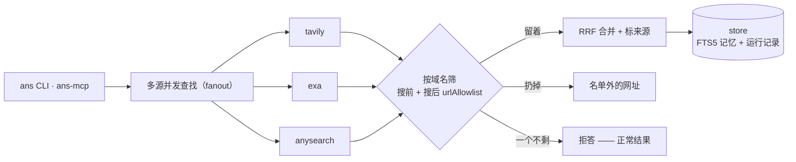

# anysearch-cli

<p align="center">
  
</p>

[English](README.md) | **简体中文**


[](https://www.npmjs.com/package/@anysearch-cli/cli)
[](https://github.com/Xxx91n/anysearch-cli/actions/workflows/ci.yml)
[](LICENSE)

垂直领域信息专家 CLI：把 search、research、memory、knowledge 放进一个 agent。
- 用 FTS5 做召回
- 用 RRF 把几个来源的结果合在一起
- 自带一个能自动索引结果的 MCP server
- 一道真能拦住返回内容的域名白名单（配了才拦）

## 快速上手

```bash
npm i -g @anysearch-cli/cli
ans doctor                                          # 自检：key、数据库路径、域配置解析、信息源是否就绪
ans search "tokio JoinSet rust"
ANS_DOMAIN=docs ans search "tokio JoinSet rust"     # 只在 docs 域里搜

# 可选：加一路向量检索，不会自动装
npm i -g @anysearch-cli/embedding
```

## 安装后：可选向量检索

`@anysearch-cli/embedding` 是可选依赖（peer-optional），没装时 CLI 只用 FTS。
装好之后（npm 或 pnpm 都行），先确认它真的激活了，再给已有记录补向量：

```bash
ans doctor                    # "vector arm (present ...)" 表示已激活
ans memory backfill-vectors   # 给已有记录补向量；第一次会下载模型（约 130 MB）
```

- 模型第一次使用时从 huggingface.co 下载，缓存在 `~/.anysearch/models`
（可以用 `ANYSEARCH_MODEL_CACHE` 改位置）。
- 离线机器可以从联网机器拷贝已经填好的缓存目录。卸载这个包后，CLI 会退回只用 FTS，不会崩，`ans doctor` 会把这一项标成 SKIP。

## 环境要求

- Node.js >= 22
- pnpm 11.24.0，版本固定；corepack 会自动读取 `packageManager`
- 搜索至少要有一个能连上的信息源（`ans recommend` 只读本地域配置，不需要 key）：
  - `EXA_API_KEY`：Exa，支持按域名筛；Exa 必须有 key
  - `TAVILY_API_KEY`：Tavily，支持按域名筛；Tavily 默认不带 key 也能跑
  - `ANYSEARCH_API_KEY`：anysearch MCP，可选；匿名层也能用，但不能在搜之前按域名筛

## 域名与拒答

*域名（domain）* 是 `domains/`（或 `ANS_DOMAINS_DIR`）下的一个 TOML 文件，
里面声明这个域用哪些信息源，还有一份说了算的白名单 `urlAllowlist`。

```bash
export ANS_DOMAIN=docs      # 选当前域
```

过滤分两步：

1. **第一步，搜之前先筛**：信息源自己说支持按域名筛，就把白名单直接交给它
   （`tavily` 用 `include_domains` 强制筛，`exa` 用 `includeDomains`）；不支持的
   （比如 `anysearch`）就不给，等第二步再筛，不会假装自己会筛。
2. **第二步，搜完再筛，这一步说了算**：信息源把结果交回来，检索引擎在合并结果、
   标来源之前，先把不在白名单里的网址全扔掉。黑名单规则优先；白名单里的条目
   管域名本身和它的子域。

这条过滤只在生效的白名单非空时运行：域 TOML 里没写 `urlAllowlist` 时通常就不过滤
（开发用的 `ANS_URL_ALLOWLIST` 覆盖项打开时，仍可能补进白名单）。
`ANS_DOMAIN` 写的域找不到时，搜索会退回所有信息源，白名单也会一起关掉，
所以先把域名和 TOML 检查一遍。

筛完一个结果都不剩时，`ans` 会**拒答（abstain）**。这是正常结果，不是报错：

```text
abstain: no results within allowed cold domain(s) (pre-filtered 0, post-filtered 0, gate pre)
```

- 默认退出码 **0**（拒答也算正常完成）；加 `--fail-on-abstain` 时，自动化
  会拿到专用退出码 **3**。
- `--json` 里有 `abstain: { abstain: true, reason, domain, preFiltered, postFiltered, gate }`；
  MCP 工具把同一个对象放在 `structuredContent.abstain`，`isError` 保持 false。
- 每次按域搜索会往运行记录里写两条审计事件：`retrieval.domain_filter.pre` 和
  `retrieval.domain_filter.post`。

> 退出码：`0` 正常或拒答 · `1` 一般失败，或没有域名策略时零结果 · `2` 用法错误 ·
`3` 开了 `--fail-on-abstain` 后的拒答。

### 编写 domain 的 description（`ans recommend`）

```bash
ans recommend "<自由文本>"
```

- 只用 **`name` + `description`** 做 BM25 排序
（若装了 `@anysearch-cli/embedding` 再加一路向量；没装就只用 FTS）。
- 它输出前 3 个候选和有多大把握：把握大就建议 `ans domain <id>`，把握小就列出候选，再附
一段机读的「为什么没推荐」——它不会自己切域。所以 description 决定模型什么时候
会想到这个域，按下面这么写（社区报告和 arXiv 2604.04323 都发现：说明写得含糊，
就会悄悄不触发）：

- 写清**这个域是干什么的**，还有**用户真会输入的具体名词**——工具、格式、站点
  （比如 `MCP spec / TypeScript tsconfig / pnpm settings`），少用形容词。
- 补上和邻近的域区分开的**关键触发词**；别直接写「不是某领域」这种否定说法——描述里的词都会被索引，它认不出否定。
- 一行，≤ ~250 字符（参考 agent skill 注册表里单条 description 的字数上限）；
  `name` 保持简短、直白，两个字段都会原样进索引。

> 域还可以通过 `[rag] adapter`（领域检索适配器）把自己的内部数据塞进 agent
的上下文：`none`（默认）、`note`（旧版固定文字）或 `fts`（真的用 FTS5 查记忆，
带来源标记）。见 [docs/rag-adapters.md](docs/rag-adapters.md)。

### 安装使用该 Agent 的 Skills（`ans skill`）

```bash
ans skill install /path/to/checkout/skills/research
ans skill validate             # 校验全部已装 skill；也可以只指定一个名字
ans skill list
ans skill uninstall research

# 项目级：每条命令都加 --project
ans skill install /path/to/checkout/skills/research --project
ans skill validate --project
ans skill list --project
ans skill uninstall research --project
```

`ans skill` 只把本地 Git 仓库里带 `SKILL.md` 的目录拷到 `skills/synced/`，
并记下来源和 commit。它不是包管理器，也不会执行 skill 里的代码。锁、清单、
残留清理这些细节看 `apps/cli/src/skill-store.ts`。

**装了不等于打开。** 这些命令不会改 domain TOML。哪些 skill 能用，还是由当前领域的
`[skills].active` 决定，打开的方式没变，还是改域配置。

## 信息源怎么连、能干什么

| 信息源 | 怎么连 | 已经接上的功能 | 直接答（answer） | 搜前筛域名 | 垂直领域路由 | 能取消吗 | 单独的用量接口 |
|----------|------|----------------|-------------|--------------|----------|------|--------------|
| anysearch | MCP Streamable HTTP（`POST /mcp`，手写 JSON-RPC；不是官方 SDK） | `search`（fast / index / deep；`answer` 请求会退成普通检索） | no | no（只能搜完再筛） | yes（`domain` / `sub_domain` / `sub_domain_params`） | yes（每次 POST 带 fetch signal；共用握手的细节见下） | no |
| exa | 官方 `exa-js` SDK | `search`（fast / index / deep / answer） | yes（`answer()` 带 citations，`verified:false`；answer 失败会退成普通检索结果，并往 stderr 写一行） | yes（`includeDomains`，只对 `search()` 生效；见下） | no | yes（`signal` 作为 `search()` / `answer()` 请求选项的最后一个参数；#216） | no |
| tavily | 官方 `@tavily/core` SDK | `search`（fast / index / deep / answer） | yes（`includeAnswer`） | yes（`include_domains`，强制筛） | no | no（`@tavily/core@0.7.7` 没有 signal；#32） | no |

信息源从 domain TOML 的 `sources.enabled` 里选。缺 key 的信息源会被跳过，
搜索不会崩；要是一个信息源都没接上，搜索直接报错，不会当成拒答。

这张表只写适配器真接上的功能，不是上游目录里写的全部。AnySearch 是这里唯一的
MCP 上游；Exa 和 Tavily 继续用官方 SDK，它们托管的 MCP 是让 agent 直接用的工具，
不是本仓服务端信息源要用的接口。**我们没打算把 Exa/Tavily 迁到 MCP。**

表里有两点要单独说：AnySearch 每次 POST 都带 signal，但几个搜索并发时共用
一次 MCP 握手，这次握手只听第一个调用方的话；后来的调用方取消不了这段等待，
第一个调用方取消也可能让两个搜索一起失败。Exa 的 `includeDomains` 只对
`search()` 生效；单独的 `answer()` 收不到白名单，检索引擎也不会去筛答案文字或
citations 里的网址。

AnySearch 适配器只接了 `search`。`get_sub_domains`、`batch_search`、`extract`
和线上有、但官方文档没写的 `score` 都没接。上游工具数量不写死：官方文档列四个，
线上还返回过 `score`。成功的 `search` 回复如果带非空 `_meta.request_id`，并且
调用方给了运行记录（CLI 和 MCP 工具调用都会给），才把它记成排查用的关联 id
（`retrieval.provider.diagnostic`）；失败的回复在提取前就抛了，不记。这个 id
不会进结果，也不能拿来当幂等键（重试时不能靠它去重）。

## AnySearch 垂直领域

AnySearch 还有一根单独的**垂直领域路由**轴。可以按查询传，也可以写在 domain TOML
里。它跟 hostname 白名单是两回事，和 `urlAllowlist` 没关系。

- 查询级参数：`search_web` / `research_web` 上的 `verticalDomain` /
  `verticalSubDomain` / `verticalParams`；CLI 的 `--vertical-domain` /
  `--vertical-sub-domain` / `--vertical-params '{"k":"v"}'`。传了查询级参数就
  整体替换 TOML 默认，不做深合并。
- 仓级默认：`[sources] vertical = { domain = "finance" }`。`sub_domain` 在这里
  可选；但 `calendar` 这种带参数的标签，必须在查询级传 `sub_domain_params`
  （`--vertical-params`），否则上游会拒。
- 看信息源自己怎么说：只有声明 `verticalDomainSupported` 的信息源（现在只有 anysearch）
  会收到 `domain` / `sub_domain` / `sub_domain_params`；别的不传，继续走普通
  查询，并在 `retrieval.vertical.pre` 审计事件里列进
  `anysearch.vertical.degraded`。丢的只是提示，不会导致拒答。
- 审计：每次垂直领域检索记一条 `retrieval.vertical.pre`，只记参数键名，不记值；
  命中的结果带 `extra.vertical`，给程序读。

详细词表和上游实测见 [docs/vertical-domains.md](docs/vertical-domains.md)。

## MCP 服务器

```bash
npm i -g @anysearch-cli/mcp                     # 提供 ans-mcp 命令
ans-mcp                                         # stdio transport（默认）
ans-mcp --transport http --port 3001            # Streamable HTTP（只绑本机）
```

从源码跑起来时，同一个入口是
`node apps/mcp/dist/index.cjs [--transport http] [--port <n>]`。

五个工具：`search_web`、`research_web`、`recall_memory`、`query_knowledge`、
`ans_chat`。`ANS_DOMAIN` 通过进程环境限定 server 范围：直接启动 `ans-mcp` 时
要显式导出；`ans mcp` 会继承 CLI 里选好的域。工具绝不往 stdout 输出，server
保持协议通道纯净。

工具参数、`isError` / 空结果 / 拒答语义、两种传输、环境变量与认证、
`ans_chat` 的会话 id、新旧版本并存的行为和上游信息源矩阵，见规范参考
[docs/mcp-server.md](docs/mcp-server.md)。

## 工作原理

一次检索的流程：几个信息源分头去查，按域名筛，结果合起来写进数据库。



## 已验证 Agent 宿主

| 宿主 | 版本 | 验过什么 | 状态 |
|------|---------|----------------|--------|
| CodeBuddy Code | 2.151.0 | `mcp.json` 注册 + `.codebuddy/settings.json` hooks | 真跑过 · [专文](docs/codebuddy-integration.md) |
| Claude Code | 2.1.251 | `mcp.json` 注册 + `.claude/settings.json` hooks + plugin 骨架 | 真跑过 · [专文](docs/claude-integration.md) |
| Codex CLI | 0.142.5 | `config.toml` MCP 注册 + `.codex/hooks.json` hooks | 真跑过 · [专文](docs/codex-integration.md) |
| Antigravity CLI（`agy`） | 1.2.5 | named-hook map `hooks.json`（5 个事件经 argv 传入） | 真跑过（只验了一部分） · [专文](docs/antigravity-integration.md) |
| Antigravity IDE | 2.12.2 | `.antigravity/rules/anysearch.mdc` 兜底 | IDE 宿主不执行 hooks（已复现） · [专文](docs/antigravity-integration.md) |
| DeepSeek Harness（`dsh`） | 0.1.7-rc.2 | 原生注册（`ctx.tools`）+ `dsh-plugin` Cordis bundle | 真跑过（靠兜底路径） · [专文](docs/deepseek-harness-integration.md) |

这里说的“已验证”，是指在真实宿主里跑过一轮，抓到了完整的对话记录
（`stream-json`），不是只看接口长什么样。完整范围、日期和探针证据都在各专文里。

## 已知限制

| 限制 | 影响 |
|------------|----------------|
| macOS 退出时 `libc++abi` 可能 abort | 原因是进程里还有原生对象活着时强行 `process.exit()`，不是 sqlite 句柄泄漏。store 退出已改成先关句柄再自然退出，macOS 也重新放回 `ship-gate` 的阻断检查。只要强制退出时还有原生对象，仍可能 abort；`macos-spillover-probe` 继续做不阻断的预警 |
| `anysearch` 信息源没法在搜之前筛域名 | 它的 MCP `domain` 参数是垂直领域路由的枚举，不是 hostname 白名单；有域名白名单时只能等搜完再筛 |
| `anysearch` 适配器只接了 `search` | `get_sub_domains`、`batch_search`、`extract` 和线上有、但官方文档没写的 `score` 都没接；上游工具数量不写死（官方文档列四个，线上还返回过 `score`）。成功的 `search` 回复里的 `_meta.request_id` 只是运行记录里的诊断数据，而且只有调用方给了 span 才记；失败回复不记。它绝不会进结果，也不能当幂等键用 |
| 退出时 `libc++abi` 可能盖掉拒答的退出码 | 自动化必须读结构化的拒答标记（`--json` / `structuredContent.abstain`），不能只看退出码 |
| `rag.adapter = "fts"` 没在任何出厂域打开 | 三个出厂域都还是 `adapter = "none"`；要按域打开，得自己手动写（#130） |
| `query_knowledge` 只有在当前领域开了 `rag.adapter = "fts"` 时才查 | 它通过领域检索适配器的注册表（#155）读整个 store 共用的调研资料库；`none` / `note` 返回明确的空结果，出厂域都是 `none`，所以默认安装回答为空 |
| 省略 `[rag]` 不等于 `adapter = "none"` | `rag` 这段是写了就整段替换：继承出来的域会用基域的 adapter/note；整条继承链都没有 adapter 就校验不过 |
| `rag.adapter = "fts"` 读的是**整个 store 共用**的调研资料库，不是当前会话 | 这是故意的边界（#130）：store 才是隔离单位，会话和域只是它下面的小范围。出厂域都是 `none`，所以 `fts` 注入要自己打开（`recall_memory` 本来就读同一个 store 范围） |
| MCP 新旧版本并存：`2026-07-28` 的客户端会被谈成 `2025-11-25` | stdio 和无状态 Streamable HTTP 的 `initialize` 对现代客户端回 `2025-11-25`，五个工具照常能用；旧客户端拿到自己的版本。手写路径只支持旧版：在 stdio / in-memory（或 HTTP 不带 `MCP-Protocol-Version` 头）时，带现代 `_meta` 的 `server/discover` 返回 `-32601`，`tools/list` 退回五个工具的旧版表。HTTP 上，非 initialize 请求带 `MCP-Protocol-Version: 2026-07-28` 会在分发前被传输层拒绝（HTTP 400 / JSON-RPC `-32000`），应该用谈下来的 `2025-11-25`。细节见 [docs/mcp-server.md](docs/mcp-server.md) |
| MCP 客户端身份只在单次请求里有效 | `2026-07-28` 的 `tools/call` 如果带 `_meta["io.modelcontextprotocol/clientInfo"]`，会记录映射后的 `client_id`；旧版 `2025-11-25` 的无状态 HTTP 调用没有单次请求身份，记录为 `mcp_unknown`。`initialize` 时提取只是兜底，不是跨请求保证 |

完整记录：[docs/limitations.md](docs/limitations.md)。

## 为什么这么设计

- **垂直领域**：域就是一份 TOML 文件，里面写死一份说了算的白名单 `urlAllowlist`，
  由检索引擎强制执行，不是写在提示词里盼着模型听话。
- **没结果就直说**：筛完一个不剩就是正常拒答，绝不编答案。
- **出故障就放行**：钩子、信息源、可选组件坏了就跳过，不把宿主 agent 拖死。

## 给贡献者

- `GLOSSARY.md`：领域术语权威表（先读）
- `docs/mcp-server.md`：MCP server 规范参考（工具、语义、传输、环境变量与认证）
- `docs/rag-adapters.md`：领域检索适配器配置（`none` / `note` / `fts`）、注入的内容和长度上限
- `docs/limitations.md`：完整的已知限制记录
- `docs/agents/`：domain 文档和 GitHub issue tracker 的约定
- 仓库布局：`packages/kernel`（引擎）· `packages/store`（FTS5 记忆、运行记录、
  URL 策略）· `packages/retriever`（信息源适配器 + RRF）· `apps/cli` ·
  `apps/mcp` · `apps/plugin`（宿主 hooks）
- 单包测试跑 `node --import tsx --test`；完整门禁是
  `node scripts/ship-gate.mjs`（净树、测试、打包、安装验证、MCP initialize、
  出故障也能启动）
- 治理：`AGENTS.md`、`docs/agents/`

从源码构建：

```bash
git clone <this repo> && cd anysearch-cli
pnpm install --ignore-scripts --node-linker=hoisted   # better-sqlite3 用预编译，免 node-gyp；hoisted 规避 Windows EPERM
pnpm build
node apps/cli/dist/index.js doctor
ANS_DOMAIN=docs node apps/cli/dist/index.js search "tokio JoinSet rust"

# 机器可读输出（包含证据够不够、来源标记、拒答）
node apps/cli/dist/index.js search "..." --json
```

CLI 在全局安装或 link 后解析为 `ans`；仓库形态下
`node apps/cli/dist/index.js` 是同一个入口。
