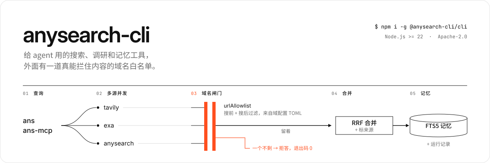
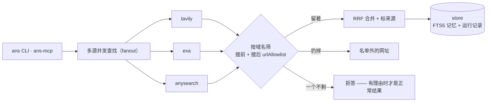

# anysearch-cli

<p align="center">
  <picture>
    <source media="(prefers-color-scheme: dark)" srcset="./docs/assets/readme/hero.zh-CN-dark.svg">
    
  </picture>
</p>

[English](README.md) | **简体中文**


[](https://www.npmjs.com/package/@anysearch-cli/cli)
[](https://github.com/Xxx91n/anysearch-cli/actions/workflows/ci.yml)
[](LICENSE)

垂直领域信息专家 CLI：把 search、research、memory、knowledge 放进一个 agent。
- 用 FTS5 做召回
- 用 RRF 把几个来源的结果合在一起
- 自带一个能自动索引结果的 MCP server
- 一道真能拦住搜索结果的域名白名单（配了才拦；信息源自己写的答案不筛）

## 快速上手

```bash
npm i -g @anysearch-cli/cli
ans doctor                                          # 分层自检：安装 / 能力 / 宿主 / 数据，逐条说清可用、未配置、未检查、失败
ans doctor --live                                   # 同上，外加有 key 的那几家信息源各打一次免费面：这把 key 还能不能用（不跑搜索、不花额度）
ans search "tokio JoinSet rust"
ANS_DOMAIN=docs ans search "tokio JoinSet rust"     # 只在 docs 域里搜

# 可选：加一路向量检索，不会自动装
npm i -g @anysearch-cli/embedding
```

`ans doctor --live` 只打有 key 的那几家。没配 key 的信息源仍是「未配置」，不探——doctor 不验
免费额度这条路。理由写在 `doctor.ts` 的 `runDoctor` 里跳过没配 key 那段旁边的 `Design:` 注释，
探针本身的规矩在 `probes.ts`（`PROBES`）。

完整产品包带上了 `ans`、`ans-mcp`、`ans-plugin-server`、`ans-hook-*`
命令，以及领域配置和宿主资源。运行 `ans --installation`，或给上面任意一个命令加
`--installation`，就能看到构建提交、版本、安装目录和入口类型。`ans mcp`
启动同一安装里的 MCP，各入口仍然各跑各的进程，向量能力照旧按需安装。

## 安装后：可选向量检索

`@anysearch-cli/embedding` 是可选依赖（peer-optional），没装时 CLI 只用 FTS。
装好之后（npm 或 pnpm 都行），先确认它真的激活了，再给已有记录补向量：

```bash
ans doctor                    # 「vector arm：present …」表示已激活
ans memory backfill-vectors   # 给已有记录补向量；第一次会下载模型（约 130 MB）
```

- 模型第一次使用时从 huggingface.co 下载，缓存在 `~/.ans/models`
（可以用 `ANYSEARCH_MODEL_CACHE` 改位置）。
- 离线机器可以从联网机器拷贝已经填好的缓存目录。卸载这个包后，CLI 会退回只用 FTS，不会崩，`ans doctor` 会把这一项标成未配置（不是失败）。

## 环境要求

- Node.js >= 22.19.0
- pnpm 11.24.0，版本固定；corepack 会自动读取 `packageManager`
- 搜索至少要有一个能连上的信息源（`ans recommend` 只读本地域配置，不需要 key）：
  - `EXA_API_KEY`：Exa，支持按域名筛；没配 key 也能用免费额度跑
  - `TAVILY_API_KEY`：Tavily，支持按域名筛；Tavily 默认用免费额度也能跑
  - `ANYSEARCH_API_KEY`：anysearch MCP，可选；免费额度也能用，但不能在搜之前按域名筛

### key 录一次就够：`ans auth set`

```bash
ans auth set openai            # 输入时看不见，只存一次
ans auth list                  # 看存了哪些、各自绑到哪个 provider 和端点
ans auth remove openai         # 删掉这一条
ans auth repair                # 文件坏了：能读的都留下，只丢掉坏掉的那几条
```

- 存在 `~/.ans/credentials.json`，**是明文**，不是加密，也不是系统钥匙串。文件里自己写明了这点。
- 本机同一账户的所有入口都读它，包括没有 shell 环境的 GUI 宿主；所以录一次就够了。
- 环境变量仍然优先：`ANS_LLM_API_KEY`、或该 provider 自己的 `*_API_KEY`。
- 每条绑定到具体的 provider；模型用的 key 还会绑定到当时的端点。换了端点或 provider 就不会发出去，要重新录。
- 文件坏了（不是 JSON、结构不对、某条读不了）时，`set` 和 `remove` 都不会去改写它，只报错并点名文件；`ans auth` 把看不见的 provider 标成 `[BROKEN]` 而不是 `not set`，退出码 1。要修就 `ans auth repair`，能读的条目留下，只丢读不了的那几条。
- 写之前按平台自己的方式建访问保护并核对：POSIX 看 600，Windows 看解析出来的 ACL（不是拿 POSIX mode 冒充）。建不起来就明确失败，不会宽松落盘。

## 域名与拒答

*域名（domain）* 是 `domains/`（或 `ANS_DOMAINS_DIR`）下的一个 TOML 文件，
里面声明这个域用哪些信息源，还有一份说了算的白名单 `urlAllowlist`。

```bash
export ANS_DOMAIN=docs      # 选当前域
```

过滤分两步：

1. **第一步，搜之前先筛**：信息源自己说支持按域名筛，就把白名单直接交给它
   （`tavily` 用 `include_domains` 强制筛，`exa` 用 `includeDomains`）；不支持的
   （比如 `anysearch`）就不给，等第二步再筛，不会假装自己会筛。
2. **第二步，搜完再筛，这一步说了算**：信息源把结果交回来，检索引擎在合并结果、
   标来源之前，先把不在白名单里的网址全扔掉。黑名单规则优先；白名单里的条目
   管域名本身和它的子域。

这条过滤只在生效的白名单非空时运行：域 TOML 里没写 `urlAllowlist` 时通常就不过滤
（开发用的 `ANS_URL_ALLOWLIST` 覆盖项还要配 `ANS_ALLOW_ENV_OVERRIDE=1` 才生效，生效后仍可能补进白名单）。
`ANS_DOMAIN` 写的域找不到时，搜索会退回所有信息源，白名单也会一起关掉，
所以先把域名和 TOML 检查一遍。

筛完一个结果都不剩时，`ans` 可能会**拒答（abstain）**——但得说得出理由：要么闸门自己筛掉过东西，要么问过的每一家都答完、一家没失败。这是正常结果，不是报错：

```text
abstain: no results within allowed cold domain(s) (pre-filtered 0, post-filtered 0, gate pre)
```

- 默认退出码 **0**（拒答也算正常完成）；加 `--fail-on-abstain` 时，自动化会拿到专用退出码 **3**。
- 零结果但不算拒答就是失败：信息源全挂了，或者挂了几家、其余几家什么都没给，`ans` 退出 **1**，点出挂掉的是谁，不会赖到域策略头上。
- `--json` 在标记成立时给 `abstain: { abstain: true, reason, domain, preFiltered, postFiltered, gate }`；每次搜索还带 `outcome`（`answer` / `abstain` / `empty` / `failed` / `cancelled`）。
  MCP 工具把同一个对象放在 `structuredContent.abstain`，`isError` 保持 false。
- 每次按域搜索会往运行记录里写两条审计事件：`retrieval.domain_filter.pre` 和
  `retrieval.domain_filter.post`。
- `research_web` 的拒答标记只代表最后一轮；前几轮可能已经有结果。

> 退出码：`0` 正常或拒答 · `1` 一般失败，或零结果但不算拒答 · `2` 用法错误 · `3` 开了 `--fail-on-abstain` 后的拒答 · `4` 升级暂停了新任务（`ans upgrade cancel` 解封）。

### 编写 domain 的 description（`ans recommend`）

```bash
ans recommend "<自由文本>"
```

- 只用 **`name` + `description`** 做 BM25 排序
（若装了 `@anysearch-cli/embedding` 再加一路向量；没装就只用 FTS）。
- 它输出前 3 个候选和有多大把握：把握大就建议 `ans domain <id>`，把握小就列出候选，再附
一段机读的「为什么没推荐」——它不会自己切域。所以 description 决定模型什么时候
会想到这个域，按下面这么写（社区报告和 arXiv 2604.04323 都发现：说明写得含糊，
就会悄悄不触发）：

- 写清**这个域是干什么的**，还有**用户真会输入的具体名词**——工具、格式、站点
  （比如 `MCP spec / TypeScript tsconfig / pnpm settings`），少用形容词。
- 补上和邻近的域区分开的**关键触发词**；别直接写「不是某领域」这种否定说法——描述里的词都会被索引，它认不出否定。
- 一行，≤ ~250 字符（参考 agent skill 注册表里单条 description 的字数上限）；
  `name` 保持简短、直白，两个字段都会原样进索引。

> 域还可以通过 `[rag] adapter`（领域检索适配器）把自己的内部数据塞进 agent
的上下文：`none`（默认）、`note`（旧版固定文字）或 `fts`（真的用 FTS5 查记忆，
带来源标记）。见 [docs/rag-adapters.md](docs/rag-adapters.md)。

### 安装使用该 Agent 的 Skills（`ans skill`）

```bash
ans skill install /path/to/checkout/apps/plugin/skills/ans
ans skill validate             # 校验全部已装 skill；也可以只指定一个名字
ans skill list
ans skill uninstall ans

# 项目级：每条命令都加 --project
ans skill install /path/to/checkout/apps/plugin/skills/ans --project
ans skill validate --project
ans skill list --project
ans skill uninstall ans --project
```

`ans skill` 只把本地 Git 仓库里带 `SKILL.md` 的目录拷到 `skills/synced/`，
并记下来源和 commit。它不是包管理器，也不会执行 skill 里的代码。锁、清单、
残留清理这些细节看 `apps/cli/src/skill-store.ts`。

`install` 和 `validate` 查的是 [Agent Skills 规范](https://agentskills.io/specification) 里这个仓库认的几条，外加几条自己的规矩：
frontmatter 是 YAML mapping，`name` 是 1–64 位小写字母数字加单连字符（不能是 Windows 保留设备名），
`description` 1–1024 字，正文少于 500 行。`description` 没写「什么时候用」不会被拒，三个入口都打一句 `note` 提醒。
源目录叫什么名字都行（clone 下来的仓库一般不是 skill 名）；`ans skill validate` 和
`node scripts/check-skills.mjs`（查本仓库所有 `SKILL.md`）另外要求 `name` 和所在目录同名。

**装了不等于打开。** 这些命令不会改 domain TOML：
- **`[skills].active` 里的名字是什么**：域 TOML 里声明的技能键名（出厂域写的是 `search`、`doctor`、`research` 这类运行时能力名），不是去 `skills/synced/` 自动加载目录的开关。
- **`[skills.toolRequires]` 现在干什么**：保留的可选「技能 → 所需工具」过滤表（`filterAgentTools` 按 `hooks.toolWhitelist ∩ (∪ toolRequires[active] ∪ {search})` 筛工具）。出厂域一个都没写它；没写 `toolRequires` 时，只靠 `hooks.toolWhitelist` 筛工具，`[skills].active` 写什么都不影响运行时。
- **装好的 skill 靠什么被用上**：`ans skill install` 只是把整个 skill 目录（含 `SKILL.md`）拷进 `skills/synced/` 供宿主 agent（或人）按文件读取（`PiAgentRuntime` 固定 `noSkills: true`，自己不读 `skills/synced/`）；要是想让某个名字在运行时参与筛工具，得在当前域的 TOML 里同时写上 `[skills].active` 和 `[skills.toolRequires]`。

## 信息源怎么连、能干什么

每家信息源连什么、适配器真接上了哪些能力、能不能取消、有没有单独的用量接口，表在这里：[上游信息源对照表](docs/mcp-server.md#upstream-provider-transport-matrix)。

## AnySearch 垂直领域

AnySearch 还有一根单独的**垂直领域路由**轴。可以按查询传，也可以写在 domain TOML
里。它跟 hostname 白名单是两回事，和 `urlAllowlist` 没关系。

- 查询级参数：`search_web` / `research_web` 上的 `verticalDomain` /
  `verticalSubDomain` / `verticalParams`；CLI 的 `--vertical-domain` /
  `--vertical-sub-domain` / `--vertical-params '{"k":"v"}'`。传了查询级参数就
  整体替换 TOML 默认，不做深合并。
- 仓级默认：`[sources] vertical = { domain = "finance" }`。`sub_domain` 在这里
  可选；但 `calendar` 这种带参数的标签，必须在查询级传 `sub_domain_params`
  （`--vertical-params`），否则上游会拒。
- 看信息源自己怎么说：只有声明 `verticalDomainSupported` 的信息源（现在只有 anysearch）
  会收到 `domain` / `sub_domain` / `sub_domain_params`；别的不传，继续走普通
  查询，并在 `retrieval.vertical.pre` 审计事件里列进
  `anysearch.vertical.degraded`。丢的只是提示，不会导致拒答。
- 审计：每次垂直领域检索记一条 `retrieval.vertical.pre`，只记参数键名，不记值；
  命中的结果带 `extra.vertical`，给程序读。

详细词表和上游实测见 [docs/vertical-domains.md](docs/vertical-domains.md)。

## MCP 服务器

```bash
npm i -g @anysearch-cli/cli                     # 一次装齐 CLI、MCP 和钩子命令
ans-mcp                                         # stdio transport（默认）
ans-mcp --transport http --port 3001            # Streamable HTTP（只绑本机）
```

从源码跑起来时，同一个入口是
`node apps/mcp/dist/index.js [--transport http] [--port <n>]`。

五个工具：`search_web`、`research_web`、`recall_memory`、`query_knowledge`、
`ans_chat`。`ANS_DOMAIN` 通过进程环境限定 server 范围：直接启动 `ans-mcp` 时
要显式导出；`ans mcp` 会继承 CLI 里选好的域。工具绝不往 stdout 输出，server
保持协议通道纯净。

工具参数、`isError` / 空结果 / 拒答语义、两种传输、环境变量与认证、
`ans_chat` 的会话 id、新旧版本并存的行为和上游信息源矩阵，见规范参考
[docs/mcp-server.md](docs/mcp-server.md)。

## 工作原理

一次检索的流程：几个信息源分头去查，按域名筛，结果合起来写进数据库。



## 已验证 Agent 宿主

| 宿主 | 版本 | 验过什么 | 状态 |
|------|---------|----------------|--------|
| CodeBuddy Code | 2.151.0 | `mcp.json` 注册 + `.codebuddy/settings.json` hooks | 真跑过 · [专文](docs/codebuddy-integration.md) |
| Claude Code | 2.1.251 | `mcp.json` 注册 + `.claude/settings.json` hooks + plugin 骨架 | 真跑过 · [专文](docs/claude-integration.md) |
| Codex CLI | 0.142.5 | `config.toml` MCP 注册 + `.codex/hooks.json` hooks | 真跑过 · [专文](docs/codex-integration.md) |
| Antigravity CLI（`agy`） | 1.2.5 | named-hook map `hooks.json`（5 个事件经 argv 传入） | 真跑过（只验了一部分） · [专文](docs/antigravity-integration.md) |
| Antigravity IDE | 2.12.2 | `.antigravity/rules/anysearch.mdc` 兜底 | IDE 宿主不执行 hooks（已复现） · [专文](docs/antigravity-integration.md) |
| DeepSeek Harness（`dsh`） | 0.2.2-rc.1 | 原生注册（`ctx.tools`）+ `dsh-plugin` Cordis bundle | 真跑过（网页对话 + 热重载） · [专文](docs/deepseek-harness-integration.md) |

这里说的“已验证”，是指在真实宿主里跑过一轮，抓到了完整的对话记录
（`stream-json`），不是只看接口长什么样。完整范围、日期和探针证据都在各专文里。

## 已知限制

| 限制 | 影响 |
|------------|----------------|
| macOS 退出时 `libc++abi` 可能 abort | 原因是进程里还有原生对象活着时强行 `process.exit()`，不是 sqlite 句柄泄漏。store 退出已改成先关句柄再自然退出，macOS 也重新放回 `ship-gate` 的阻断检查。只要强制退出时还有原生对象，仍可能 abort；`macos-spillover-probe` 继续做不阻断的预警 |
| `anysearch` 信息源没法在搜之前筛域名 | 它的 MCP `domain` 参数是垂直领域路由的枚举，不是 hostname 白名单；有域名白名单时只能等搜完再筛 |
| `anysearch` 适配器只接了 `search` | `get_sub_domains`、`batch_search`、`extract` 和线上有、但官方文档没写的 `score` 都没接；上游工具数量不写死（官方文档列四个，线上还返回过 `score`）。成功的 `search` 回复里的 `_meta.request_id` 只是运行记录里的诊断数据，而且只有调用方给了 span 才记；失败回复不记。它绝不会进结果，也不能当幂等键用 |
| 退出时 `libc++abi` 可能盖掉拒答的退出码 | 自动化必须读结构化的拒答标记（`--json` / `structuredContent.abstain`），不能只看退出码 |
| `rag.adapter = "fts"` 没在任何出厂域打开 | 三个出厂域都还是 `adapter = "none"`；要按域打开，得自己手动写（#130） |
| `query_knowledge` 只有在当前领域开了 `rag.adapter = "fts"` 时才查 | 它通过领域检索适配器的注册表（#155）读整个 store 共用的调研资料库；`none` / `note` 返回明确的空结果，出厂域都是 `none`，所以默认安装回答为空 |
| 省略 `[rag]` 不等于 `adapter = "none"` | `rag` 这段是写了就整段替换：继承出来的域会用基域的 adapter/note；整条继承链都没有 adapter 就校验不过 |
| `rag.adapter = "fts"` 读的是**整个 store 共用**的调研资料库，不是当前会话 | 这是故意的边界（#130）：store 才是隔离单位，会话和域只是它下面的小范围。出厂域都是 `none`，所以 `fts` 注入要自己打开（`recall_memory` 本来就读同一个 store 范围） |
| MCP 新旧版本并存：`2026-07-28` 的客户端会被谈成 `2025-11-25` | stdio 和无状态 Streamable HTTP 的 `initialize` 对现代客户端回 `2025-11-25`，五个工具照常能用；旧客户端拿到自己的版本。手写路径只支持旧版：在 stdio / in-memory（或 HTTP 不带 `MCP-Protocol-Version` 头）时，带现代 `_meta` 的 `server/discover` 返回 `-32601`，`tools/list` 退回五个工具的旧版表。HTTP 上，非 initialize 请求带 `MCP-Protocol-Version: 2026-07-28` 会在分发前被传输层拒绝（HTTP 400 / JSON-RPC `-32000`），应该用谈下来的 `2025-11-25`。细节见 [docs/mcp-server.md](docs/mcp-server.md) |
| MCP 客户端身份只在单次请求里有效 | `2026-07-28` 的 `tools/call` 如果带 `_meta["io.modelcontextprotocol/clientInfo"]`，会记录映射后的 `client_id`；旧版 `2025-11-25` 的无状态 HTTP 调用没有单次请求身份，记录为 `mcp_unknown`。`initialize` 时提取只是兜底，不是跨请求保证 |

完整记录：[docs/limitations.md](docs/limitations.md)。

## 为什么这么设计

- **垂直领域**：域就是一份 TOML 文件，里面写死一份说了算的白名单 `urlAllowlist`，
  由检索引擎强制执行，不是写在提示词里盼着模型听话。
- **没结果就直说**：能说清是域策略筛空的，就干净拒答，绝不编答案。
- **出故障就放行**：钩子、信息源、可选组件坏了就跳过，不把宿主 agent 拖死。

## 给贡献者

- `GLOSSARY.md`：领域术语权威表（先读）
- `docs/mcp-server.md`：MCP server 规范参考（工具、语义、传输、环境变量与认证）
- `docs/rag-adapters.md`：领域检索适配器配置（`none` / `note` / `fts`）、注入的内容和长度上限
- `docs/limitations.md`：完整的已知限制记录
- `docs/agents/`：domain 文档和 GitHub issue tracker 的约定
- 仓库布局：`packages/kernel`（引擎）· `packages/store`（FTS5 记忆、运行记录、
  URL 策略）· `packages/retriever`（信息源适配器 + RRF）· `apps/cli` ·
  `apps/mcp` · `apps/plugin`（宿主 hooks）
- 单包测试跑 `node --import tsx --test`；发布前的完整检查是
  `node scripts/ship-gate.mjs`（工作区没有未提交的改动、测试、打包、安装验证、MCP initialize、
  出故障也能启动）
- 治理：`AGENTS.md`、`docs/agents/`

从源码构建：

```bash
git clone <this repo> && cd anysearch-cli
pnpm install --ignore-scripts --node-linker=hoisted   # better-sqlite3 用预编译，免 node-gyp；hoisted 规避 Windows EPERM
pnpm build
node apps/cli/dist/index.js doctor
ANS_DOMAIN=docs node apps/cli/dist/index.js search "tokio JoinSet rust"

# 机器可读输出（包含证据够不够、来源标记、拒答）
node apps/cli/dist/index.js search "..." --json
```

源码开发模式的 MCP 入口会复用完整产品的构建产物。首次运行前，以及修改 MCP 或钩子源码后，先构建再启动：

```bash
pnpm -C apps/cli build
pnpm -C apps/cli dev mcp --help
```

CLI 在全局安装或 link 后解析为 `ans`；仓库形态下
`node apps/cli/dist/index.js` 是同一个入口。
