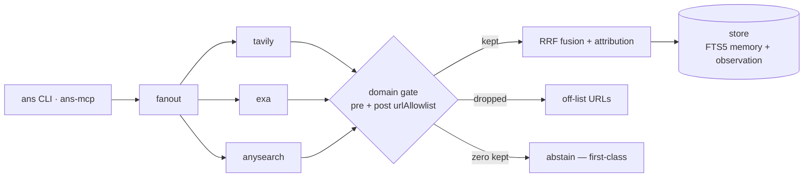

# anysearch-cli

<p align="center">
  
</p>

[English](README.md) | **简体中文**

> 本文档为翻译件，规范以 [README.md](README.md) 为准。

[](https://www.npmjs.com/package/@anysearch-cli/cli)
[](https://github.com/Xxx91n/anysearch-cli/actions/workflows/ci.yml)
[](LICENSE)

垂直领域信息专家 CLI：search + research + memory + knowledge 合于一个
agent——FTS5 召回、多路 RRF 融合、自动索引结果的 MCP server，以及一道
真正拦得住返回内容的域名 allowlist。

**状态：已发布 npm** — `npm i -g @anysearch-cli/cli`（自 0.0.4 起经 npm
OIDC trusted publishing 发布，含 sigstore provenance；0.0.1/0.0.2 因
`workspace:*` peer 逃逸作废——见 CHANGELOG）。

域门限定搜索的真实输出——返回的每个 URL 都在该域 `urlAllowlist` 内；
闸门后为空则是一等公民弃权：

```text
$ ANS_DOMAIN=docs ans search "model context protocol"
1. [tavily] What is the Model Context Protocol (MCP)? - Model Context Protocol
   modelcontextprotocol.io/
2. [exa]
   modelcontextprotocol.io/specification/2026-07-28/basic
3. [exa]
   modelcontextprotocol.io/specification/2026%2D07%2D28
   …

# when the gate leaves zero results — a first-class abstain, not an error:
abstain: no results within allowed cold domain(s) (pre-filtered 0, post-filtered 0, gate pre)
```

## 环境要求

- Node.js >= 22（Node 24 已验证）
- pnpm 11.24.0 精确版本（钉死；corepack 自动读取 `packageManager`）
- 真实搜索至少需要一个 provider API key：
  - `EXA_API_KEY` — Exa（支持域名过滤）
  - `TAVILY_API_KEY` — Tavily（支持域名过滤）
  - `ANYSEARCH_API_KEY` — anysearch MCP（可选；匿名层可用，无域名过滤）

## 快速上手

```bash
npm i -g @anysearch-cli/cli
ans doctor                                          # self-check: keys, DB path, domain resolution, provider readiness
ans search "tokio JoinSet rust"                     # first search (full fanout across keyed providers)
ANS_DOMAIN=docs ans search "tokio JoinSet rust"     # domain-scoped search

# optional vector arm (peer-optional — never auto-installed):
npm i -g @anysearch-cli/embedding
```

从源码构建（贡献者）：

```bash
git clone <this repo> && cd anysearch-cli
pnpm install --ignore-scripts --node-linker=hoisted   # better-sqlite3 预编译免 node-gyp；hoisted 规避 Windows EPERM
pnpm build
node apps/cli/dist/index.js doctor
ANS_DOMAIN=docs node apps/cli/dist/index.js search "tokio JoinSet rust"

# machine-readable output (includes sufficiency / attribution / abstain)
node apps/cli/dist/index.js search "..." --json
```

CLI 在全局安装或 link 后解析为 `ans`；仓库形态下
`node apps/cli/dist/index.js` 是同一入口。

## 安装后：向量臂

`@anysearch-cli/embedding` 是 peer-optional —— 未安装时 CLI 以 FTS-only 运行。
全局安装后（npm 或 pnpm），验证激活并为存量记录补向量：

```bash
ans doctor                    # "vector arm (present ...)" confirms activation
ans memory backfill-vectors   # embeds stored rows; first run downloads the model (~130 MB)
```

模型首次使用时从 huggingface.co 下载，缓存于
`~/.anysearch/models`（可用 `ANYSEARCH_MODEL_CACHE` 覆盖）。离线主机可从联网
机器拷贝已填充的缓存目录。卸载该包后 CLI 退回 FTS-only 模式 —— 不崩溃，
`ans doctor` 将该臂报为 SKIP。

## 域名与弃权

*域名（domain）*是 `domains/`（或 `ANS_DOMAINS_DIR`）下的一个 TOML 文件，
声明其 providers 与权威 `urlAllowlist`；`ANS_DOMAIN` 负责选择。

过滤以两道闸运行：

1. **前置过滤（按能力协商）** —— 声明支持域名过滤的 provider 直接收到
   allowlist（`tavily`：`include_domains` 硬过滤模式；`exa`：
   `includeDomains`）；不支持的 provider（如 `anysearch`）诚实降级为
   仅后置过滤——绝不为它们伪造过滤能力。
2. **后置过滤（权威）** —— provider 返回后，kernel 在融合/归因之前丢弃
   所有 URL 不在 allowlist 的结果。deny 规则优先；allow 条目匹配宿主
   及其子域。

当闸门后结果为零，`ans` **弃权（abstain）** —— 一等公民结果，不是错误：

```text
abstain: no results within allowed cold domain(s) (pre-filtered 0, post-filtered 0, gate pre)
```

- 默认退出码 **0**（弃权是成功的策略结果）；`--fail-on-abstain` 为自动化
  返回专用退出码 **3**。
- `--json` 携带 `abstain: { reason, domain, preFiltered, postFiltered, gate }`；
  MCP 工具以 `structuredContent.abstain` + `isError: false` 呈现。
- 每次域名限定搜索在观测轨迹里落地两条审计事件：
  `retrieval.domain_filter.pre` 与 `retrieval.domain_filter.post`。

退出码：`0` 正常/弃权 · `1` 一般失败或无域名策略下的零结果 · `2` 用法
错误 · `3` `--fail-on-abstain` 下的弃权。

### 编写 domain 的 description（`ans recommend`）

`ans recommend "<自由文本>"` 只用 **`name` + `description`** 做 BM25 排序
（装了 `@anysearch-cli/embedding` 时叠加可选的向量臂；未安装则降级为纯
FTS）。输出 top-3 候选与置信度：高置信建议 `ans domain <id>`，低置信列出
候选并附结构化的「为什么没推荐」行——绝不自动切换。因此 description 就是
触发面，请按下面规范写（证据：社区报告与 arXiv 2604.04323 均发现模糊的
description 会被静默忽略——写得好坏是触发成败的关键）：

- 写清**这个 domain 用来做什么**，以及**用户真会输入的具体名词**——
  工具、格式、站点（如 `MCP spec / TypeScript tsconfig / pnpm settings`），
  少用形容词。
- 补充与兄弟 domain 区分开的**关键触发词**，并隐含它*不是*什么（语料纳入
  规则）。
- 一行、≤ ~250 字符（agent skill 注册表的单条 description 预算先例）；
  `name` 保持简短字面义——两个字段都会被原样索引。

### 安装 Agent Skills（`ans skill`）

`ans skill` 是最小安装器，不是包管理器。它从**本地 Git checkout** 拷贝根目录
含 `SKILL.md` 的自包含目录。请先 checkout 到目标 commit/tag；安装器记录来源、
完整 HEAD commit、存在时的精确 tag，以及来源是否含未提交修改。它不克隆仓库、
不解析依赖，也不执行 skill 中的代码。

```bash
ans skill install /path/to/checkout/skills/research
ans skill validate             # 校验全部已装 skill；也可指定一个名字
ans skill list
ans skill uninstall research

# 项目级：每条命令都加 --project
ans skill install /path/to/checkout/skills/research --project
ans skill validate --project
ans skill list --project
ans skill uninstall research --project
```

默认用户级（可用 `--user` 显式选择）：

```text
~/.anysearch-cli/skills/synced/installed.json
~/.anysearch-cli/skills/synced/<name>/SKILL.md
<项目>/.anysearch/skills/synced/installed.json
<项目>/.anysearch/skills/synced/<name>/SKILL.md
```

`synced/` 是机器管理区；同级 `skills/<name>/` 留给用户手写。`SKILL.md` 必须以
可解析的 YAML frontmatter mapping 开头，其中 `name` 为 1–64 位小写字母/数字，
可用单个连字符分隔（不能是 Windows 设备名），并据此选择安装目录。这里只检查
语法和名字，不是完整的 Agent Skills linter。Git 元数据会省略，符号链接会被
拒绝；已有安装绝不覆盖（请先卸载）。

版本 1 的 `installed.json` 含按名字索引的 `skills` 对象；每项记录 `name`、
绝对路径 `source`、`commit`、`dirty` 和可选 `tag`。清单缺失、损坏或不符合
schema 时，卸载会拒绝且不删除任何文件；绝不靠扫描目录猜测删除目标。
`install` 与 `uninstall` 在所选 scope 内持独占锁：两个并发变更不会互相丢失
清单条目。锁内记录持有者（`pid`、`host`）。同一 host 上可证明已死的持有者会
被自动回收；仍存活的锁、在另一台机器写入的锁，或 owner 记录不可读的锁一律
fail-closed，绝不自动删除。因此被杀进程不会永久阻塞后续操作，除非锁来自另一台
机器——此时请在确认该机器没有 `ans skill` 进程运行后，删除残留的
`skills/synced/.installed.lock` 目录。清单发布以及安装/卸载的目录 rename 遇到
Windows 瞬时共享冲突（`EPERM`/`EBUSY`/`ENOTEMPTY`）会做有界退避重试，最长约
60 秒，耗尽后仍报告原始错误。

`install`、`uninstall`、`list`、`validate` 还会在持锁时对账安装器自有残留：
仅在不存在 `installed.json` 时清理 `.install-*` 暂存目录和 `.installed-*.tmp`
临时清单；`.uninstall-*` 备份、未登记的 `<name>/` 目录和未知条目永不自动删除。
安装中断留下的未登记 `<name>/` 可手工删除后重装。若清单仍记录某 skill 但其
`<name>/` 目录缺失，`ans skill list`（以及 `validate`）会输出恢复提示：把对应的
`.uninstall-*` 备份改回 `<name>/`，没有备份时用 `ans skill uninstall <name>`
删掉这条失效记录（项目级加 `--project`）。已存在 `installed.json` 时留下的 `.installed-*.tmp`
不会被自动删除，请在手工清理前先查看 `skills/synced/`。回收中断留下的
`.installed.lock.reclaim-*` 遵循同样的“无清单才清理”规则：仅在没有
`installed.json`、且其记录的持有者于本机可证明已死时清理；否则报告并保留。
若 `ans skill list`
本身报告清单缺失或损坏，请先直接查看 `skills/synced/` 再动手删除。

**安装不等于激活。** 这些命令绝不改写 domain TOML。Skill Active List 仍由
Active Domain 的 `[skills].active` 决定，激活仍按原方式通过 domain 配置管理。

## Provider 域名过滤矩阵

| provider | 前置过滤已下发 | 降级模式 |
|----------|-----------------|--------------|
| tavily   | yes（`include_domains`，硬过滤模式） | — |
| exa      | yes（`includeDomains`） | — |
| anysearch| no（MCP `domain` 是垂域路由枚举，不是 hostname allowlist） | 仅后置过滤 |

Provider 选择来自域名 TOML 的 `sources.enabled`。缺 key 的 provider 被
跳过而非崩溃（fail-open）；若*没有任何* provider 能注册，搜索是错误
而非弃权。

## AnySearch 垂域

anysearch provider 另有一根正交轴：服务端**垂域路由**。可按查询（CLI 旗标
或 MCP 工具参数）或按域名 TOML 设置——它不是 hostname allowlist，与
`urlAllowlist` 完全不相干。

- 查询级参数（整体替换 TOML 默认，绝不深合并）：`search_web` 与
  `research_web` 上的 `verticalDomain` / `verticalSubDomain` /
  `verticalParams`；CLI `--vertical-domain` / `--vertical-sub-domain` /
  `--vertical-params '{"k":"v"}'`。
- 仓级默认：域名 TOML 里 `[sources] vertical = { domain = "finance" }`
  （只放静态亲和——`sub_domain` 在这里可选；但 `calendar` 这类带参标签没有
  查询级 `sub_domain_params`（`--vertical-params`）会被上游拒）。
- 能力协商：仅声明 `verticalDomainSupported` 的 provider（当前只有
  anysearch）收 wire 字段 `domain` / `sub_domain` / `sub_domain_params`；
  其余走 general 扇出并记入 `retrieval.vertical.pre` 审计事件的
  `anysearch.vertical.degraded` 名单（丢的是提示，绝不弃权）。
- 审计：每次垂域检索落一条 `retrieval.vertical.pre`——
  属性 `anysearch.vertical.domain` / `.sub_domain` / `.params_keys`
  （只记键名，值绝不进审计）/ `.source`（repo|query）/ `.sent` /
  `.degraded`。垂域命中在每条 NormalizedResult 上携 `extra.vertical`
  机读标记。

带日期的 domain 词表快照与上游实测语义移至
[docs/vertical-domains.md](docs/vertical-domains.md)。

## MCP 服务器

```bash
node apps/mcp/dist/index.cjs                    # stdio transport (default)
node apps/mcp/dist/index.cjs --transport http --port 3099   # HTTP
```

五个工具：`search_web`、`research_web`、`recall_memory`、`query_knowledge`、
`ans_chat`。`ANS_DOMAIN` 以与 CLI 相同的方式限定 server 范围。
工具绝不向 stdout 输出；server 保持协议通道纯净。

## 工作原理

一次检索的管线——providers 扇出、域门过滤、结果融合并落库：



## 已验证 Agent 宿主

| 宿主 | 版本 | 已验证范围 | 状态 |
|------|---------|----------------|--------|
| CodeBuddy Code | 2.151.0 | `mcp.json` 注册 + `.codebuddy/settings.json` hooks | 实机验证 · [专文](docs/codebuddy-integration.md) |
| Claude Code | 2.1.251 | `mcp.json` 注册 + `.claude/settings.json` hooks + plugin 骨架 | 实机验证 · [专文](docs/claude-integration.md) |
| Codex CLI | 0.142.5 | `config.toml` MCP 注册 + `.codex/hooks.json` hooks | 实机验证 · [专文](docs/codex-integration.md) |
| Antigravity CLI（`agy`） | 1.2.5 | named-hook map `hooks.json`（5 事件经 argv 传入） | 实机验证（裁剪矩阵） · [专文](docs/antigravity-integration.md) |
| Antigravity IDE | 2.12.2 | `.antigravity/rules/anysearch.mdc` 兜底 | IDE 宿主不执行 hooks（已复现） · [专文](docs/antigravity-integration.md) |
| DeepSeek Harness（`dsh`） | 0.1.7-rc.2 | 原生注册（`ctx.tools`）+ `dsh-plugin` Cordis bundle | 实机验证（established-via-fallback） · [专文](docs/deepseek-harness-integration.md) |

"已验证"指在真实宿主上捕获端到端 transcript（`stream-json`），而非契约
同构——完整范围、日期与探针证据见各专文链接。

## 已知限制

| 限制 | 影响 |
|------------|----------------|
| macOS 在阻断矩阵之外 | 未解决的退出时 `libc++abi` 崩溃使 `ship-gate` 只闸 ubuntu+windows；macOS 以非阻断 probe 车道运行 |
| `anysearch` provider 无法前置过滤 | 其 MCP `domain` 参数是垂域路由枚举（不是 hostname allowlist）——域名 allowlist 下诚实降级为仅后置过滤 |
| 退出时 `libc++abi` 可能覆盖弃权退出码 | 自动化必须读结构化弃权标记（`--json` / `structuredContent.abstain`），不能只看退出码 |

完整记录：[docs/limitations.md](docs/limitations.md)。

## 设计取舍

- **垂直领域** —— 域名是带权威 `urlAllowlist` 的 TOML 策略文件，在
  kernel 内强制执行，不是提示词愿望。
- **弃权优先** —— 闸门后为空是一等公民的弃权结果，绝不编造答案。
- **Fail-open** —— hooks、providers 与可选 peer 诚实降级，不拖垮宿主
  agent。

## 面向贡献者

- `GLOSSARY.md` —— 领域术语 canonical 表（先读）
- `docs/limitations.md` —— 完整已知限制记录
- `docs/agents/` —— domain-doc + GitHub issue tracker 约定
- 仓库布局：`packages/kernel`（引擎）· `packages/store`（FTS5 记忆、
  观测、URL 策略）· `packages/retriever`（provider 适配器 + RRF）·
  `apps/cli` · `apps/mcp` · `apps/plugin`（宿主 hooks）
- 单包测试跑 `node --import tsx --test`；完整门禁 =
  `node scripts/ship-gate.mjs`（净树、测试、打包、安装验证、MCP
  initialize、fail-open 启动）
- 治理：`AGENTS.md`、`docs/agents/`
