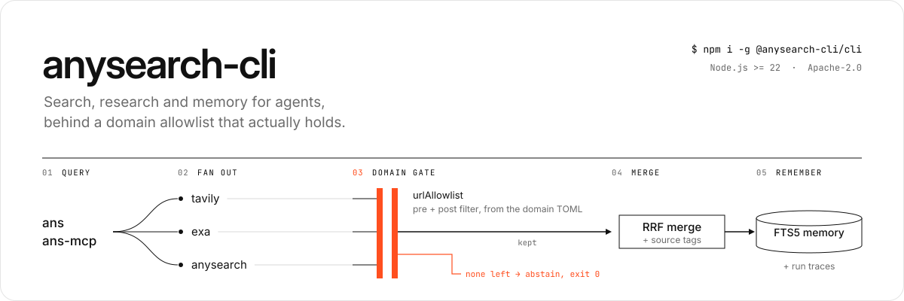
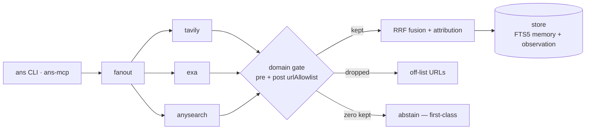

# anysearch-cli

<p align="center">
  
</p>

[English](README.md) | **简体中文**

> 英文版是主文档，中文版会跟着同步。

[](https://www.npmjs.com/package/@anysearch-cli/cli)
[](https://github.com/Xxx91n/anysearch-cli/actions/workflows/ci.yml)
[](LICENSE)

垂直领域信息专家 CLI：把 search、research、memory、knowledge 放进一个 agent。
它用 FTS5 做召回，用 RRF 把多个来源的结果合在一起，自带一个能自动索引结果的
MCP server，还有一道真正能拦住返回内容的域名 allowlist。

已发布到 npm：`npm i -g @anysearch-cli/cli`。0.0.1/0.0.2 因为 `workspace:*`
依赖问题作废，细节见 CHANGELOG。

域门限定后的搜索大概是这样：

```text
$ ANS_DOMAIN=docs ans search "model context protocol"
1. [tavily] What is the Model Context Protocol (MCP)? ...
2. [exa] ...
3. [exa] ...

# 域内没有结果时直接弃权，不报错：
abstain: no results within allowed cold domain(s) (pre-filtered 0, post-filtered 0, gate pre)
```

## 环境要求

- Node.js >= 22（Node 24 已验证）
- pnpm 11.24.0，版本固定；corepack 会自动读取 `packageManager`
- 真实搜索至少需要一个 provider（检索服务商）的 API key：
  - `EXA_API_KEY`：Exa，支持域名过滤
  - `TAVILY_API_KEY`：Tavily，支持域名过滤
  - `ANYSEARCH_API_KEY`：anysearch MCP，可选；匿名层也能用，但不能按域名前置过滤

## 快速上手

```bash
npm i -g @anysearch-cli/cli
ans doctor                                          # 自检：key、数据库路径、domain 解析、provider 是否就绪
ans search "tokio JoinSet rust"
ANS_DOMAIN=docs ans search "tokio JoinSet rust"     # 只在 docs 域里搜

# 可选：向量臂，不会自动安装
npm i -g @anysearch-cli/embedding
```

## 安装后：向量臂

`@anysearch-cli/embedding` 是可选依赖（peer-optional），没装时 CLI 只用 FTS。
全局安装后（npm 或 pnpm），先确认它已经激活，再给已有记录补向量：

```bash
ans doctor                    # "vector arm (present ...)" 表示已激活
ans memory backfill-vectors   # 给已有记录补向量；第一次会下载模型（约 130 MB）
```

模型第一次使用时从 huggingface.co 下载，缓存在 `~/.anysearch/models`
（可以用 `ANYSEARCH_MODEL_CACHE` 改位置）。离线机器可以从联网机器拷贝已经填好的
缓存目录。卸载这个包后，CLI 会退回只用 FTS 模式，不会崩，`ans doctor` 会把这一臂
标成 SKIP。

## 域名与弃权

*域名（domain）*是 `domains/`（或 `ANS_DOMAINS_DIR`）下的一个 TOML 文件，
里面声明这个域用哪些 provider，以及一份权威的 `urlAllowlist`。用 `ANS_DOMAIN`
选当前域。

过滤分两道闸：

1. **前置过滤（按能力协商）**：声明支持域名过滤的 provider 会直接收到 allowlist
   （`tavily` 用 `include_domains` 强制过滤，`exa` 用 `includeDomains`）；不支持
   前置过滤的 provider（比如 `anysearch`）只做后置过滤，不会假装自己会过滤。
2. **后置过滤（权威）**：provider 返回后，kernel 在融合和归因之前，把不在
   allowlist 里的 URL 全部丢掉。deny 规则优先；allow 条目匹配域名和它的子域。

域门后结果为零时，`ans` **弃权（abstain）**。这是一等公民的结果，不是错误：

```text
abstain: no results within allowed cold domain(s) (pre-filtered 0, post-filtered 0, gate pre)
```

- 默认退出码 **0**（弃权是成功的策略结果）；加 `--fail-on-abstain` 时，自动化
  会拿到专用退出码 **3**。
- `--json` 里有 `abstain: { reason, domain, preFiltered, postFiltered, gate }`；
  MCP 工具用 `structuredContent.abstain` + `isError: false` 表示同样的事。
- 每次按域搜索会往观测轨迹里写两条审计事件：`retrieval.domain_filter.pre` 和
  `retrieval.domain_filter.post`。

退出码：`0` 正常或弃权 · `1` 一般失败，或没有域名策略时零结果 · `2` 用法错误 ·
`3` 开了 `--fail-on-abstain` 后的弃权。

### 编写 domain 的 description（`ans recommend`）

`ans recommend "<自由文本>"` 只用 **`name` + `description`** 做 BM25 排序
（装了 `@anysearch-cli/embedding` 时再加一路向量；没装就只用 FTS）。它输出
top-3 候选和置信度：高置信会建议 `ans domain <id>`，低置信会列出候选，并附一行
结构化的“为什么没推荐”——它不会自己切域。所以 description 就是触发面，按下面
这么写（社区报告和 arXiv 2604.04323 都发现：描述写得模糊，就会静默不触发）：

- 写清**这个域是干什么的**，以及**用户真会输入的具体名词**——工具、格式、站点
  （比如 `MCP spec / TypeScript tsconfig / pnpm settings`），少用形容词。
- 补上和兄弟域区分开的**关键触发词**，也隐含它*不是*什么（这是语料纳入规则）。
- 一行，≤ ~250 字符（参考 agent skill 注册表单条 description 的预算先例）；
  `name` 保持简短、字面，两个字段都会被原样索引。

域还可以通过 `[rag] adapter`（领域检索适配器）把自己的内部数据注入 agent 上下文：`none`（默认）、
`note`（旧版固定文本）或 `fts`（真正的 FTS5 记忆检索，带来源标记）。见
[docs/rag-adapters.md](docs/rag-adapters.md)。

### 安装 Agent Skills（`ans skill`）

```bash
ans skill install /path/to/checkout/skills/research
ans skill validate             # 校验全部已装 skill；也可以只指定一个名字
ans skill list
ans skill uninstall research

# 项目级：每条命令都加 --project
ans skill install /path/to/checkout/skills/research --project
ans skill validate --project
ans skill list --project
ans skill uninstall research --project
```

`ans skill` 只是把本地 checkout 里带 `SKILL.md` 的目录拷到 `skills/synced/`，
并记下来源和 commit。它不是包管理器，也不会执行 skill 里的代码。锁、清单、
残留清理这些细节，见 `GLOSSARY.md` 的 Skill Installer 词条。

**安装不等于激活。** 这些命令不会改 domain TOML。Skill Active List 仍由
Active Domain 的 `[skills].active` 决定，激活还是按原来的方式改 domain 配置。

## Provider 传输与能力矩阵

| provider | 传输层 | 已接上的检索能力 | answer（直接答案）模式 | 域名前置过滤 | 垂域路由 | 取消 | 独立用量接口 |
|----------|------|----------------|-------------|--------------|----------|------|--------------|
| anysearch | MCP Streamable HTTP（`POST /mcp`，手写 JSON-RPC；不是官方 SDK） | `search`（fast / index / deep；`answer` 请求会降级成普通检索） | no | no（只做后置过滤） | yes（`domain` / `sub_domain` / `sub_domain_params`） | yes（每次 POST 带 fetch signal；共享握手的细节见下） | no |
| exa | 官方 `exa-js` SDK | `search`（fast / index / deep / answer） | yes（`answer()` 带 citations，`verified:false`；answer 失败会降级成检索结果，并往 stderr 写一行） | yes（`includeDomains`，只作用于 `search()`；见下） | no | yes（`signal` 作为 `search()` / `answer()` 请求选项的最后一个参数；#216） | no |
| tavily | 官方 `@tavily/core` SDK | `search`（fast / index / deep / answer） | yes（`includeAnswer`） | yes（`include_domains`，强制过滤） | no | no（`@tavily/core@0.7.7` 没暴露 signal；#32） | no |

provider 从 domain TOML 的 `sources.enabled` 里选。缺 key 的 provider 会被跳过，
不会让搜索崩掉；如果一个 provider 都没能注册，搜索直接报错，不会当成弃权。

这张表只写适配器真正接上的能力，不是各上游目录里列的全部能力。AnySearch 是这里
唯一的 MCP 上游；Exa 和 Tavily 继续用官方 SDK，它们的托管 MCP 是给 agent 直接用
的工具面，不是本仓服务端 provider 的接口。**我们不打算把 Exa/Tavily 迁到 MCP。**

表里有两点取消上的细节：AnySearch 每次 POST 都带 signal，但并发搜索共用一次
MCP 握手，这段握手只跟第一个调用方的 signal；后来的调用方取消不了这段等待，
第一个调用方取消也可能让两个搜索一起失败。Exa 的 `includeDomains` 只作用于
`search()`；单独的 `answer()` 不会收到 allowlist，kernel 也不会对答案文本或
citations 做 URL 过滤。

AnySearch 适配器只接了 `search`。`get_sub_domains`、`batch_search`、`extract`
和线上有、但官方文档没写的 `score` 都没接。上游工具数量不写死：官方文档列四个，
线上还返回过 `score`。成功的 `search` 回复如果带非空 `_meta.request_id`，并且
调用方提供了观测记录（CLI 和 MCP 工具调用都会提供），才把它记成排查用的关联 id
（`retrieval.provider.diagnostic`）；失败的回复在提取前就抛了，不记。这个 id
不会进结果，也不是幂等键。

## AnySearch 垂域

AnySearch 还有一根单独的**垂域路由**轴。可以按查询传，也可以写在 domain TOML
里。它不是 hostname allowlist，和 `urlAllowlist` 没关系。

- 查询级参数：`search_web` / `research_web` 上的 `verticalDomain` /
  `verticalSubDomain` / `verticalParams`；CLI 的 `--vertical-domain` /
  `--vertical-sub-domain` / `--vertical-params '{"k":"v"}'`。传了查询级参数就
  整体替换 TOML 默认，不做深合并。
- 仓级默认：`[sources] vertical = { domain = "finance" }`。`sub_domain` 在这里
  可选；但 `calendar` 这种带参数的标签，必须在查询级传 `sub_domain_params`
  （`--vertical-params`），否则上游会拒。
- 能力协商：只有声明 `verticalDomainSupported` 的 provider（现在只有 anysearch）
  会收到 `domain` / `sub_domain` / `sub_domain_params`；其他 provider 继续走普通
  查询，并在 `retrieval.vertical.pre` 审计事件里列进
  `anysearch.vertical.degraded`。丢的只是提示，不会弃权。
- 审计：每次垂域检索记一条 `retrieval.vertical.pre`，只记参数键名，不记值；
  命中的结果带 `extra.vertical`，给程序读。

详细词表和上游实测见 [docs/vertical-domains.md](docs/vertical-domains.md)。

## MCP 服务器

```bash
npm i -g @anysearch-cli/mcp                     # 提供 ans-mcp 命令
ans-mcp                                         # stdio transport（默认）
ans-mcp --transport http --port 3001            # Streamable HTTP（只绑本机）
```

从源码检出运行时，同一个入口是
`node apps/mcp/dist/index.cjs [--transport http] [--port <n>]`。

五个工具：`search_web`、`research_web`、`recall_memory`、`query_knowledge`、
`ans_chat`。`ANS_DOMAIN` 通过进程环境限定 server 范围：直接启动 `ans-mcp` 时
要显式导出；`ans mcp` 会继承 CLI 持久化的选择。工具绝不往 stdout 输出，server
保持协议通道纯净。

工具参数、`isError` / 空结果 / abstain 语义、两种传输、环境变量与认证、
`ans_chat` 会话句柄、dual-era 行为和上游 provider 矩阵，见规范参考
[docs/mcp-server.md](docs/mcp-server.md)。

## 工作原理

一次检索的管线：providers 分头去查，域门过滤，结果合并后写进数据库。



## 已验证 Agent 宿主

| 宿主 | 版本 | 已验证范围 | 状态 |
|------|---------|----------------|--------|
| CodeBuddy Code | 2.151.0 | `mcp.json` 注册 + `.codebuddy/settings.json` hooks | 实机验证 · [专文](docs/codebuddy-integration.md) |
| Claude Code | 2.1.251 | `mcp.json` 注册 + `.claude/settings.json` hooks + plugin 骨架 | 实机验证 · [专文](docs/claude-integration.md) |
| Codex CLI | 0.142.5 | `config.toml` MCP 注册 + `.codex/hooks.json` hooks | 实机验证 · [专文](docs/codex-integration.md) |
| Antigravity CLI（`agy`） | 1.2.5 | named-hook map `hooks.json`（5 个事件经 argv 传入） | 实机验证（裁剪矩阵） · [专文](docs/antigravity-integration.md) |
| Antigravity IDE | 2.12.2 | `.antigravity/rules/anysearch.mdc` 兜底 | IDE 宿主不执行 hooks（已复现） · [专文](docs/antigravity-integration.md) |
| DeepSeek Harness（`dsh`） | 0.1.7-rc.2 | 原生注册（`ctx.tools`）+ `dsh-plugin` Cordis bundle | 实机验证（established-via-fallback） · [专文](docs/deepseek-harness-integration.md) |

这里的“已验证”是指在真实宿主里跑过一轮，抓到了完整的对话记录
（`stream-json`），不是只看接口形状。完整范围、日期和探针证据在各专文里。

## 已知限制

| 限制 | 影响 |
|------------|----------------|
| macOS 退出时 `libc++abi` 可能 abort | 根因是进程在原生状态还活着时强制 `process.exit()`，不是 sqlite handle 泄漏。store 侧退出已经改成先关 handle 再自然退出，macOS 也重新进了 `ship-gate` 阻断矩阵；但任何在原生状态还活着时强制退出的进程仍可能 abort，`macos-spillover-probe` 继续做非阻断预警 |
| `anysearch` provider 无法前置过滤 | 它的 MCP `domain` 参数是垂域路由枚举，不是 hostname allowlist；有域名 allowlist 时只能诚实地做后置过滤 |
| `anysearch` 适配器只接了 `search` | `get_sub_domains`、`batch_search`、`extract` 和线上有、但官方文档没写的 `score` 都没接；上游工具数量不写死（官方文档列四个，线上还返回过 `score`）。成功的 `search` 回复里的 `_meta.request_id` 只是观测 trace 的诊断数据，而且只有调用方提供 span 时才记；失败回复不记。它绝不会进结果，也不是幂等键 |
| 退出时 `libc++abi` 可能覆盖弃权退出码 | 自动化必须读结构化的弃权标记（`--json` / `structuredContent.abstain`），不能只看退出码 |
| `rag.adapter = "fts"` 没在任何出厂域启用 | 三个出厂域都保持 `adapter = "none"`；要按域启用，得自己显式打开（#130） |
| `query_knowledge` 只有在 Active Domain 开了 `rag.adapter = "fts"` 时才检索 | 它经 RAG 注册表（#155）读 store 级共享的 Research Memory；`none` / `note` 返回显式空结果，出厂域都是 `none`，所以默认安装回答为空 |
| 省略 `[rag]` 不等于 `adapter = "none"` | `rag` 是声明即替换的段：派生域会继承基域的 adapter/note，链路里完全没有 adapter 则校验失败 |
| `rag.adapter = "fts"` 读的是 **store 级共享** Research Memory，不是当前会话 | 这是刻意边界（#130）：store 是隔离单元，会话和域只是子作用域。出厂域都在 `none`，所以 `fts` 注入要自己打开（`recall_memory` 本来就读同一个 store 范围） |
| MCP 双时代：`2026-07-28` 客户端会被协商降到 `2025-11-25` | stdio 和无状态 Streamable HTTP 的 `initialize` 对现代客户端返回 `2025-11-25`，五个工具仍可用；legacy 客户端会拿到自己的版本。手写路径仍是 legacy-only：在 stdio / in-memory（或不带 `MCP-Protocol-Version` 头的 HTTP）上，带现代 `_meta` 信封的 `server/discover` 返回 `-32601`，`tools/list` 仍会降级成五工具 legacy 表。HTTP 上，非 initialize 请求如果带 `MCP-Protocol-Version: 2026-07-28`，会在分发前被传输层拒绝（HTTP 400 / JSON-RPC `-32000`），应该用协商得到的 `2025-11-25`。细节见 [docs/mcp-server.md](docs/mcp-server.md) |
| MCP 客户端身份只在单次请求里有效 | `2026-07-28` 的 `tools/call` 如果带 `_meta["io.modelcontextprotocol/clientInfo"]`，会记录映射后的 `client_id`；legacy `2025-11-25` 的无状态 HTTP 调用没有单次请求身份，记录为 `mcp_unknown`。`initialize` 时的提取只是兜底，不是跨请求保证 |

完整记录：[docs/limitations.md](docs/limitations.md)。

## 设计取舍

- **垂直领域**：域是带权威 `urlAllowlist` 的 TOML 策略文件，由 kernel 强制执行，
  不是提示词愿望。
- **弃权优先**：域门后为空是一等公民的弃权结果，绝不编造答案。
- **Fail-open**：hooks、providers 和可选 peer 诚实降级，不拖垮宿主 agent。

## 面向贡献者

- `GLOSSARY.md`：领域术语权威表（先读）
- `docs/mcp-server.md`：MCP server 规范参考（工具、语义、传输、环境变量与认证）
- `docs/rag-adapters.md`：RAG adapter 配置（`none` / `note` / `fts`）、注入形状和预算
- `docs/limitations.md`：完整已知限制记录
- `docs/agents/`：domain-doc + GitHub issue tracker 约定
- 仓库布局：`packages/kernel`（引擎）· `packages/store`（FTS5 记忆、观测、
  URL 策略）· `packages/retriever`（provider 适配器 + RRF）· `apps/cli` ·
  `apps/mcp` · `apps/plugin`（宿主 hooks）
- 单包测试跑 `node --import tsx --test`；完整门禁是
  `node scripts/ship-gate.mjs`（净树、测试、打包、安装验证、MCP initialize、
  fail-open 启动）
- 治理：`AGENTS.md`、`docs/agents/`

从源码构建：

```bash
git clone <this repo> && cd anysearch-cli
pnpm install --ignore-scripts --node-linker=hoisted   # better-sqlite3 用预编译，免 node-gyp；hoisted 规避 Windows EPERM
pnpm build
node apps/cli/dist/index.js doctor
ANS_DOMAIN=docs node apps/cli/dist/index.js search "tokio JoinSet rust"

# 机器可读输出（包含 sufficiency / attribution / abstain）
node apps/cli/dist/index.js search "..." --json
```

CLI 在全局安装或 link 后解析为 `ans`；仓库形态下
`node apps/cli/dist/index.js` 是同一个入口。
